# Games for Teddy & Tommy 🎮

**▶ Dashboard: https://adong.github.io/games-for-teddy-tommy/**

Browser games starring two brothers: Teddy, with his boxing combos and basketball jump shot, and Tommy, with his ✌️ Y pose. Every game has a companion mode where you call the other brother in to help. They all play on phones, tablets and computers, with nothing to install. In any game, press **?** (or tap the round **?** button on the left edge) to see its keys; the game waits while you look. Every game, and the dashboard, switches between **English and 中文** with the language button (the A文 icon); English is the default, and the choice carries over to every game.

**中文：** 主角是兄弟俩：会拳击和跳投的 Teddy，还有爱摆 ✌️ Y 字造型的 Tommy。每个游戏都能叫兄弟来帮忙，按 **?** 看按键。手机、平板、电脑都能玩，不用安装。每个游戏和这个首页都有语言按钮（A文 图标），默认英文，点一下切换中文，选一次，所有游戏都记住。

## Play now / 马上玩

| | Game | Play | Code |
|---|---|---|---|
|  | 🚇 **Metro Surfer**: Run the subway tracks, dodge trains, grab coins and spell words. Call your brother to keep you safe. 在地铁轨道上奔跑：躲火车、捡金币、拼单词。叫兄弟来保护你。 | [play](https://adong.github.io/metro-surfer/) | [adong/metro-surfer](https://github.com/adong/metro-surfer) |
| [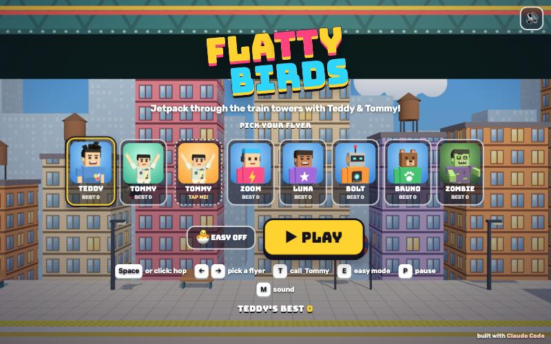](https://adong.github.io/flatty-birds/) | 🐦 **FlaTTy Birds**: Tap to flap between stacked trains and station pillars. Call your brother to fly beside you. 点一下就扇翅膀，穿过叠起来的火车和站台柱子。叫兄弟来陪你一起飞。 | [play](https://adong.github.io/flatty-birds/) | [adong/flatty-birds](https://github.com/adong/flatty-birds) |
| [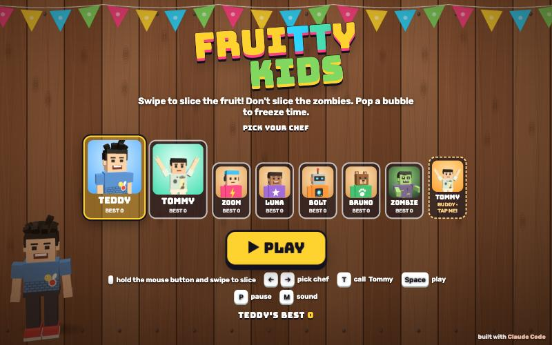](https://adong.github.io/fruitty-kids/) | 🍉 **FruiTTy Kids**: Swipe to slice flying fruit. Watch out for the zombie bombs, and call your brother as a second chef. 划一下，切开飞起来的水果。小心僵尸炸弹，叫兄弟来当第二个大厨。 | [play](https://adong.github.io/fruitty-kids/) | [adong/fruitty-kids](https://github.com/adong/fruitty-kids) |
| [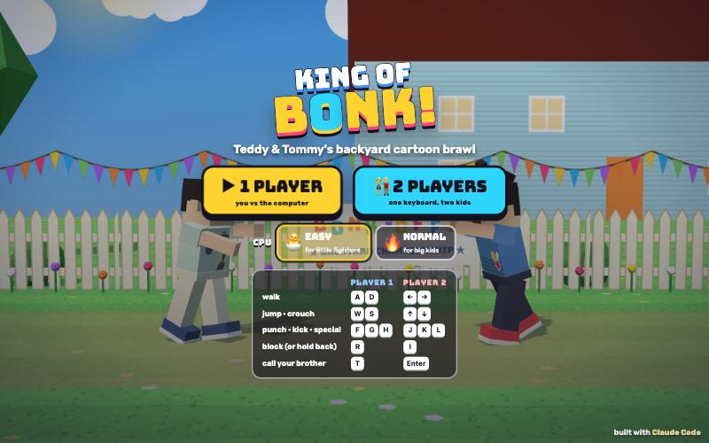](https://adong.github.io/king-of-bonk/) | 🥊 **King of Bonk!**: A cartoon backyard fight: Teddy's jab-straight vs Tommy's peace wave. 1 or 2 players. 后院卡通大乱斗：Teddy 的刺拳直拳对 Tommy 的和平波。单人或双人。 | [play](https://adong.github.io/king-of-bonk/) | [adong/king-of-bonk](https://github.com/adong/king-of-bonk) |
|  | 🎱 **Magic 8: Teddy & Tommy**: Ask a question and shake the ball, and the brothers answer. 问个问题，摇一摇魔法球，兄弟俩来回答。 | [play](https://adong.github.io/magic-8-teddy/) | [adong/magic-8-teddy](https://github.com/adong/magic-8-teddy) |
|  | 🍄 **TNT Brothers**: A side-scrolling platformer: jump, stomp zombies and reach the flag. 10 levels, 1 or 2 players. 横版闯关：跳跃、踩僵尸、冲到旗杆。10 关，单人或双人。 | [play](https://adong.github.io/tnt-brothers/) | [adong/tnt-brothers](https://github.com/adong/tnt-brothers) |
|  | 💥 **Angry TNT**: Slingshot Teddy and Tommy at wobbly zombie towers. 15 levels. 用弹弓把 Teddy 和 Tommy 弹向摇摇晃晃的僵尸塔。15 关。 | [play](https://adong.github.io/angry-tnt/) | [adong/angry-tnt](https://github.com/adong/angry-tnt) |
|  | 🧟 **Brothers vs Zombies**: Defend the backyard cookies from silly zombies with hoops, ice-cream stands and ✌️ shooters. 15 levels. 用篮筐、冰淇淋摊和 ✌️ 发射器挡住捣蛋僵尸，保卫后院的饼干。15 关。 | [play](https://adong.github.io/brothers-vs-zombies/) | [adong/brothers-vs-zombies](https://github.com/adong/brothers-vs-zombies) |
| [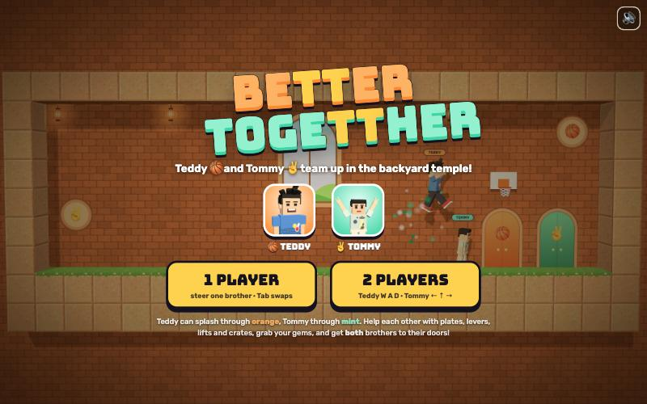](https://adong.github.io/coop-brothers/) | 🧩 **BeTTer TogeTTher**: Teamwork puzzles: orange paths for Teddy, mint ones for Tommy. 10 levels, best with 2 players. 合作解谜：橙色的路给 Teddy，薄荷绿的路给 Tommy。10 关，两个人玩最好玩。 | [play](https://adong.github.io/coop-brothers/) | [adong/coop-brothers](https://github.com/adong/coop-brothers) |
| [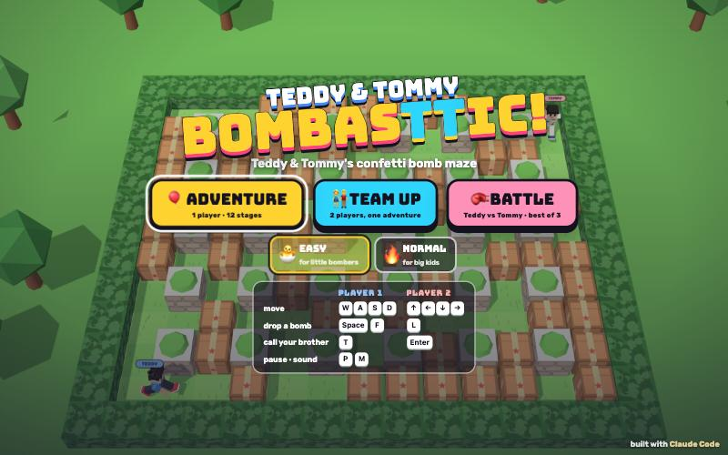](https://adong.github.io/bomber-teddy/) | 💣 **BombasTTic!**: Maze bombs and power-ups: 12 stages, team up, or battle Teddy vs Tommy. 1 or 2 players. 迷宫炸弹和道具：12 关冒险，可以组队，也可以 Teddy 对 Tommy 对战。单人或双人。 | [play](https://adong.github.io/bomber-teddy/) | [adong/bomber-teddy](https://github.com/adong/bomber-teddy) |
| [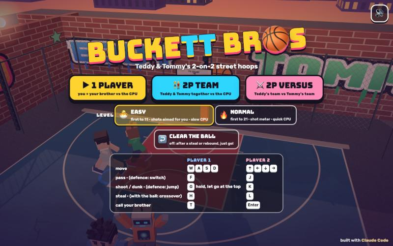](https://adong.github.io/buckett-bros/) | ⛹️ **BuckeTT Bros**: 2-on-2 street basketball: Team Teddy & Tommy, with dunks and alley-oops. 1 or 2 players. 2 对 2 街头篮球：Teddy & Tommy 队，扣篮加空中接力。单人或双人。 | [play](https://adong.github.io/buckett-bros/) | [adong/buckett-bros](https://github.com/adong/buckett-bros) |
|  | 🏀 **SwishTT Shot**: An arcade basketball shooting machine: sink Teddy's jump shot before the 60-second clock runs out. 投篮机：60 秒倒计时结束前，用 Teddy 的跳投多进几个球。 | [play](https://adong.github.io/swishtt-shot/) | [adong/swishtt-shot](https://github.com/adong/swishtt-shot) |
| [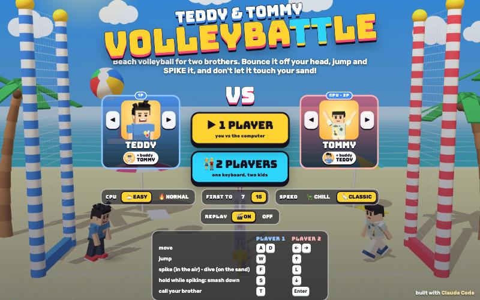](https://adong.github.io/volleyball-teddy/) | 🏐 **VolleyBaTTle**: Beach volleyball, brother vs brother: jump, spike and dive. 1 or 2 players. 兄弟对决沙滩排球：跳、扣、扑救。单人或双人。 | [play](https://adong.github.io/volleyball-teddy/) | [adong/volleyball-teddy](https://github.com/adong/volleyball-teddy) |
|  | 🎾 **Tennis: Teddy & Tommy**: Teddy vs Tommy on the park court: smash, lob, and call your brother for doubles. 1 or 2 players. Teddy 对 Tommy 公园网球赛：扣杀、高吊，还能叫兄弟来打双打。单人或双人。 | [play](https://adong.github.io/tennis-teddy/) | [adong/tennis-teddy](https://github.com/adong/tennis-teddy) |
| [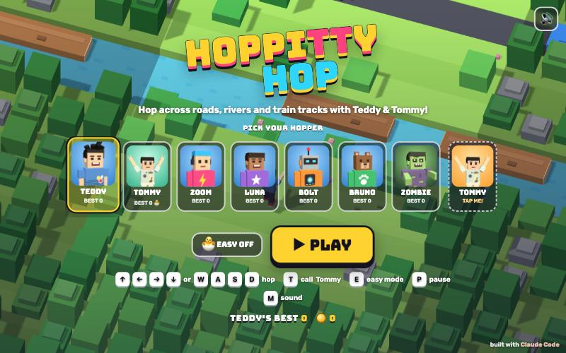](https://adong.github.io/crossy-teddy/) | 🚦 **HoppiTTy Hop**: Hop across roads, rivers and subway tracks without getting squished. 跳过马路、小河和地铁轨道，别被压扁啦。 | [play](https://adong.github.io/crossy-teddy/) | [adong/crossy-teddy](https://github.com/adong/crossy-teddy) |
| [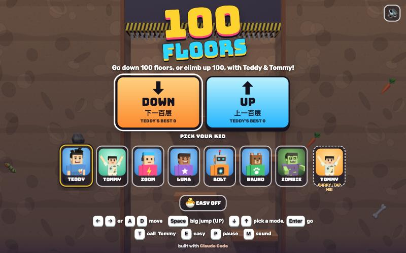](https://adong.github.io/hundred-floors/) | 🏢 **100 Floors**: Drop down 100 floors, or climb up 100: how far can you go? 是男人就下一百层，还有上一百层：你能走多远？ | [play](https://adong.github.io/hundred-floors/) | [adong/hundred-floors](https://github.com/adong/hundred-floors) |
| [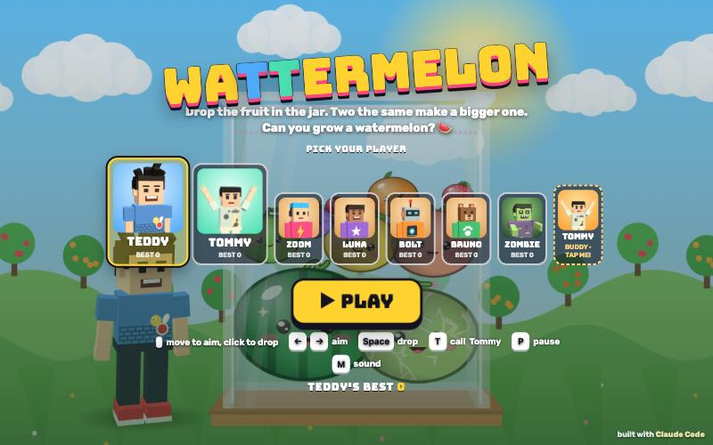](https://adong.github.io/merge-teddy/) | 🍒 **WaTTermelon**: Drop and merge fruit, all the way up to a giant watermelon. 合成大西瓜：丢水果、合水果，一路合成大西瓜。 | [play](https://adong.github.io/merge-teddy/) | [adong/merge-teddy](https://github.com/adong/merge-teddy) |
|  | 🧸 **Tommy's Toy Box**: Whack-a-zombie and memory cards for little hands. 打僵尸和记忆翻牌，给小小手玩的。 | [play](https://adong.github.io/tommy-toybox/) | [adong/tommy-toybox](https://github.com/adong/tommy-toybox) |
| [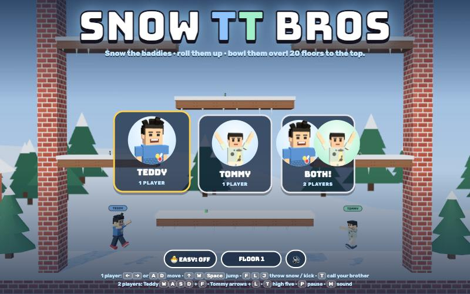](https://adong.github.io/snow-tt-bros/) | ⛄ **Snow TT Bros**: Snow the zombies into giant snowballs and roll them away. 20 floors, 1 or 2 players. 把僵尸冻成大雪球，滚起来撞倒一大片！20 层，单人或双人。 | [play](https://adong.github.io/snow-tt-bros/) | [adong/snow-tt-bros](https://github.com/adong/snow-tt-bros) |
| [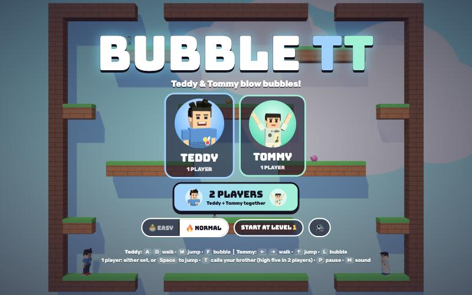](https://adong.github.io/bubble-tt/) | 🫧 **Bubble TT**: Trap zombies in bubbles and pop them together. 30 levels, 1 or 2 players. 吹泡泡困住僵尸，再一起戳破！30 关，单人或双人。 | [play](https://adong.github.io/bubble-tt/) | [adong/bubble-tt](https://github.com/adong/bubble-tt) |
| [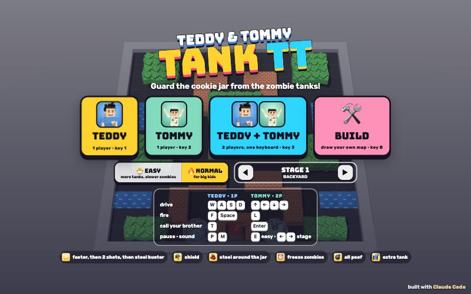](https://adong.github.io/tank-tt/) | 🚜 **Tank TT**: Two tanks guard the cookie jar from zombie tanks. 16 stages, 1 or 2 players, and you can build your own maps. 两辆坦克守护饼干罐，打退僵尸坦克。16 关，单人或双人，还能自己画地图。 | [play](https://adong.github.io/tank-tt/) | [adong/tank-tt](https://github.com/adong/tank-tt) |
|  | 🛏️ **Double TTrouble**: A brothers street brawl with pillows: silly and safe. 6 stages, 1 or 2 players. 兄弟俩的枕头街头大战，搞笑又安全。6 关，单人或双人。 | [play](https://adong.github.io/brawler-tt/) | [adong/brawler-tt](https://github.com/adong/brawler-tt) |
|  | ❄️ **SnowbaTTle**: Snowball fight! Teddy vs Tommy behind snow forts, or team up against the snowmen. 1 or 2 players. 打雪仗：Teddy 对 Tommy 躲在雪堡后面，或者组队打雪人。单人或双人。 | [play](https://adong.github.io/snowball-fight-tt/) | [adong/snowball-fight-tt](https://github.com/adong/snowball-fight-tt) |
| [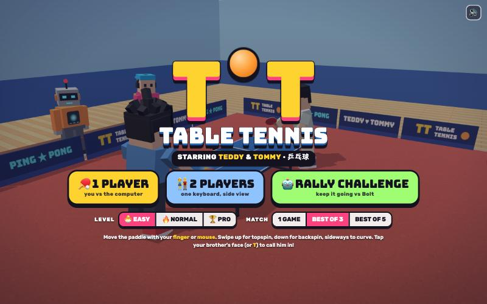](https://adong.github.io/tt-table-tennis/) | 🏓 **TT Table Tennis**: TT means Table Tennis, and Teddy & Tommy: swipe through the ball to smash and spin it. 1 or 2 players. 乒乓球：TT 是 Table Tennis，也是 Teddy & Tommy。挥拍一划，就能扣杀、打旋转球。单人或双人。 | [play](https://adong.github.io/tt-table-tennis/) | [adong/tt-table-tennis](https://github.com/adong/tt-table-tennis) |
| [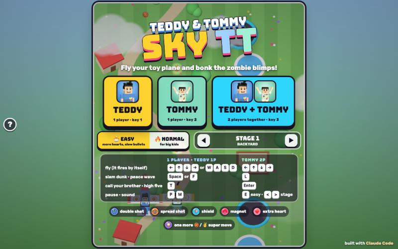](https://adong.github.io/sky-tt/) | ✈️ **Sky TT**: A classic plane shooter: fly a toy plane, bonk zombie blimps and bosses, and call your brother as a wingman. 10 stages, 1 or 2 players. 经典飞机射击：开着玩具飞机打僵尸飞艇和大魔王，叫兄弟来当僚机。10 关，单人或双人。 | [play](https://adong.github.io/sky-tt/) | [adong/sky-tt](https://github.com/adong/sky-tt) |
| [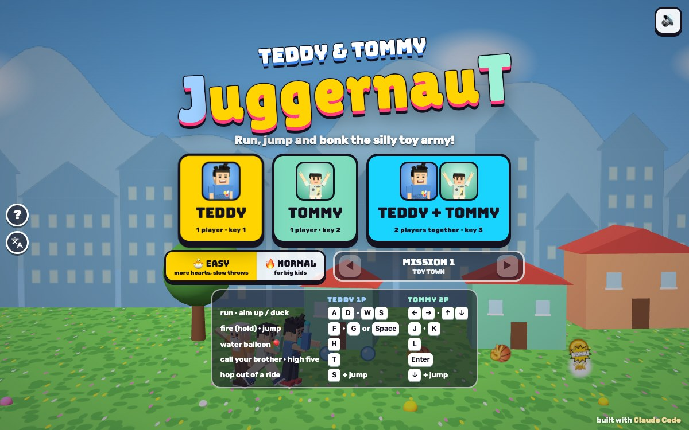](https://adong.github.io/juggernaut/) | 🪖 **JuggernauT**: A classic run-and-gun: six missions, silly rides, friends to rescue, and zombie, mummy, monkey, chubby and snowman transformations. 1 or 2 players. 经典横版射击闯关：6 个任务、搞笑坐骑、解救朋友，还会变成僵尸、木乃伊、猴子、小胖子和雪人。单人或双人。 | [play](https://adong.github.io/juggernaut/) | [adong/juggernaut](https://github.com/adong/juggernaut) |
| [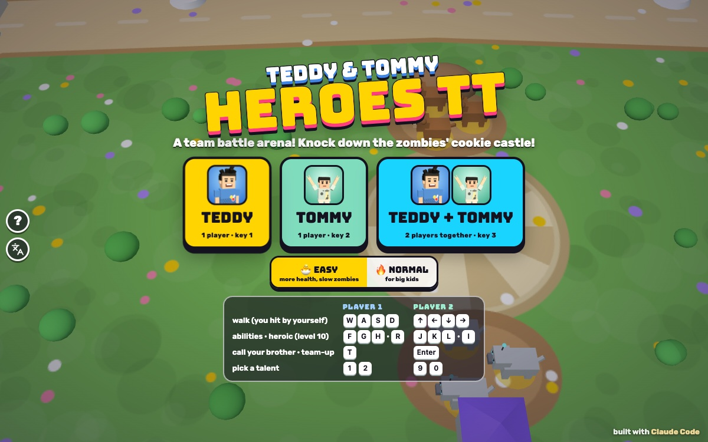](https://adong.github.io/heroes-tt/) | 🛡️ **Heroes TT**: A kid-sized team battle arena: two lanes, towers and a cookie castle to crumble. Team Teddy & Tommy vs a silly Zombie & Robot team. 1 or 2 players. 儿童版团队对战竞技场：两条路、防御塔和饼干城堡。Teddy & Tommy 队对战搞笑的僵尸机器人队。单人或双人。 | [play](https://adong.github.io/heroes-tt/) | [adong/heroes-tt](https://github.com/adong/heroes-tt) |
| [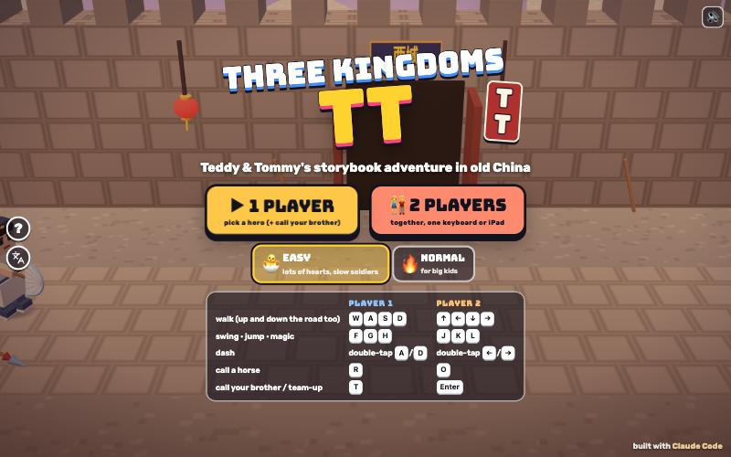](https://adong.github.io/three-kingdoms-tt/) | 🐉 **Three Kingdoms TT**: A Three Kingdoms beat-'em-up: foam weapons, magic, horses and treasure chests. 6 stages, 6 heroes, 1 or 2 players. 三国故事书闯关：泡沫武器、法术、骑马、宝箱。6 关，6 位英雄，单人或双人。 | [play](https://adong.github.io/three-kingdoms-tt/) | [adong/three-kingdoms-tt](https://github.com/adong/three-kingdoms-tt) |
| [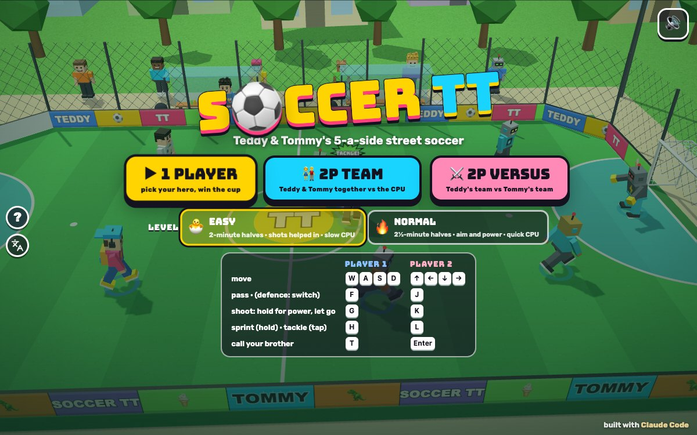](https://adong.github.io/soccer-tt/) | ⚽ **Soccer TT**: 5-a-side street soccer: Team TT against a cup ladder of silly rivals, with super shots and slow-motion goal replays. 1 or 2 players. 五人街头足球：TT 队挑战一路搞笑的对手，有超级射门和进球慢镜头回放。单人或双人。 | [play](https://adong.github.io/soccer-tt/) | [adong/soccer-tt](https://github.com/adong/soccer-tt) |
|  | ⭕ **TT Tic-Tac-Toe**: Tic-tac-toe on a big wooden board in the garden, with Teddy as X and Tommy as O: the classic game, or SPIN, where every tap turns a square over. 1 or 2 players. 花园里的大井字棋，Teddy 是 X，Tommy 是 O：普通模式，或者旋转模式（每点一下，格子就翻一面）。单人或双人。 | [play](https://adong.github.io/tic-tac-toe-tt/) | [adong/tic-tac-toe-tt](https://github.com/adong/tic-tac-toe-tt) |
|  | 🐄 **Spot TT Animals**: Teddy's own game: look through binoculars into a cornfield and count the farm animals before time runs out. 1 or 2 players. Teddy 自己设计的游戏：用望远镜看玉米地，在时间用完前数清农场动物。单人或双人。 | [play](https://adong.github.io/spot-tt-animals/) | [adong/spot-tt-animals](https://github.com/adong/spot-tt-animals) |
|  | 🏎️ **TT Kart**: Go-kart races: six cartoon tracks, silly item boxes, a Grand Prix trophy, split-screen for two and a time trial. 卡丁车比赛：六条卡通赛道、道具箱、奖杯大奖赛、上下分屏双人和计时赛。 | [play](https://adong.github.io/kart-tt/) | [adong/kart-tt](https://github.com/adong/kart-tt) |
| [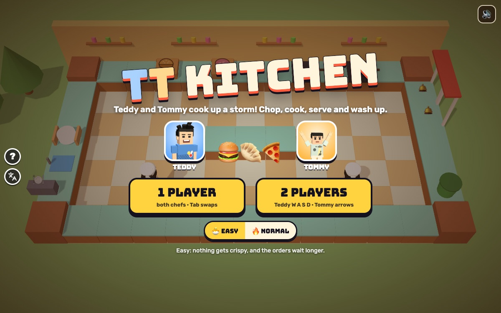](https://adong.github.io/kitchen-tt/) | 🍳 **TT Kitchen**: A co-op cooking game: chop, cook, plate, serve and wash up across 10 ever-sillier kitchens. Best with 2 players. Teddy 和 Tommy 一起当大厨：切菜、煮饭、装盘、上菜、洗盘子，10 个越来越搞笑的厨房，两个人一起玩最好玩。 | [play](https://adong.github.io/kitchen-tt/) | [adong/kitchen-tt](https://github.com/adong/kitchen-tt) |
| [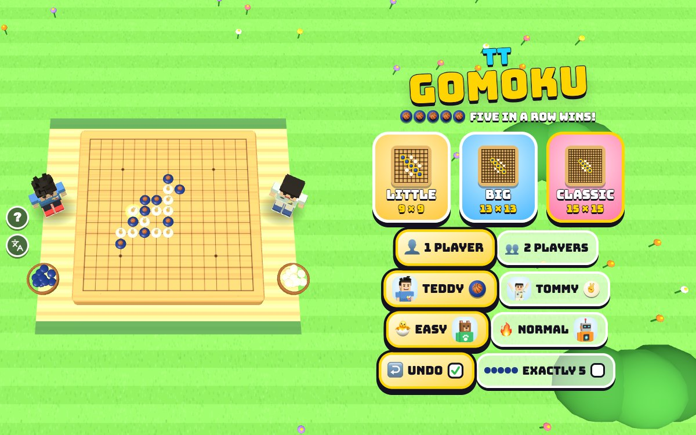](https://adong.github.io/gomoku-tt/) | ⚫ **TT Gomoku**: Five in a row on a garden board: 9×9, 13×13 or the classic 15×15. 1 or 2 players. 花园里的五子棋：五个连成一线就赢！9×9、13×13 和 15×15 棋盘，单人或双人。 | [play](https://adong.github.io/gomoku-tt/) | [adong/gomoku-tt](https://github.com/adong/gomoku-tt) |
|  | 🦁 **TT Jungle Chess**: Jungle chess on a 3D jungle board: the elephant beats the lion, and the little rat beats the elephant. 1 or 2 players. 3D 斗兽棋：象吃狮，狮吃虎……小小的鼠能吃象！单人或双人。 | [play](https://adong.github.io/jungle-chess-tt/) | [adong/jungle-chess-tt](https://github.com/adong/jungle-chess-tt) |

## How they're made

Every game is plain JavaScript on Three.js and ships as one HTML page. The characters, their poses and the sound come from a shared kit, so Teddy and Tommy look and move the same in every game. Built by Dad with [Claude Code](https://claude.com/claude-code).

Each game has one icon: its emoji on a coloured tile. The same picture is on its card here, on its browser tab, and on the iPad home screen when you add the game there. The device's own emoji font draws it, so there are no image files.

Each game's page title is its name and then "Teddy & Tommy", for example "FlaTTy Birds · Teddy & Tommy".

To add a game here, move it from `SOON` to `LIVE` in `index.html` (with its English and 中文 text, its emoji and its tile colour), save its title-screen screenshot as `shots/<repo>.jpg`, and add a row to the table above.
