# Games for Teddy & Tommy 🎮

**▶ Dashboard: https://adong.github.io/games-for-teddy-tommy/**

Browser games starring two brothers: Teddy, with his boxing combos and basketball jump shot, and Tommy, with his ✌️ Y pose. Every game has a companion mode where you call the other brother in to help. They all play on phones, tablets and computers, with nothing to install. In any game, press **?** (or tap the round **?** button on the left edge) to see its keys; the game waits while you look. Every game, and the dashboard, switches between **English and 中文** with the language button (the A文 icon); English is the default, and the choice carries over to every game.

**中文：** 主角是兄弟俩：会拳击和跳投的 Teddy，还有爱摆 ✌️ Y 字造型的 Tommy。每个游戏都能叫兄弟来帮忙，按 **?** 看按键。手机、平板、电脑都能玩，不用安装。每个游戏和这个首页都有语言按钮（A文 图标），默认英文，点一下切换中文，选一次，所有游戏都记住。

## 150 games / 150 个游戏

### 🏮 China Series / 中国系列 (24)

| | Game | Play | Code |
|---|---|---|---|
|  | 🐉 **Three Kingdoms TT**: A Three Kingdoms beat-'em-up: foam weapons, magic, horses and treasure chests. 6 stages, 6 heroes, 1 or 2 players. 三国故事书闯关：泡沫武器、法术、骑马、宝箱。6 关，6 位英雄，单人或双人。 | [play](https://adong.github.io/three-kingdoms-tt/) | [adong/three-kingdoms-tt](https://github.com/adong/three-kingdoms-tt) |
|  | 🦁 **TT Jungle Chess**: Jungle chess on a 3D jungle board: the elephant beats the lion, and the little rat beats the elephant. 1 or 2 players. 3D 斗兽棋：象吃狮，狮吃虎……小小的鼠能吃象！单人或双人。 | [play](https://adong.github.io/jungle-chess-tt/) | [adong/jungle-chess-tt](https://github.com/adong/jungle-chess-tt) |
|  | 🥋 **Kung Fu TT**: Side-scrolling kung fu: punch and kick floor by floor up a five-floor temple to rescue the Golden Panda. 1 or 2 players. 功夫小子：出拳踢腿，一层一层打上五层寺庙，救出金熊猫。单人或双人。 | [play](https://adong.github.io/kung-fu-tt/) | [adong/kung-fu-tt](https://github.com/adong/kung-fu-tt) |
| [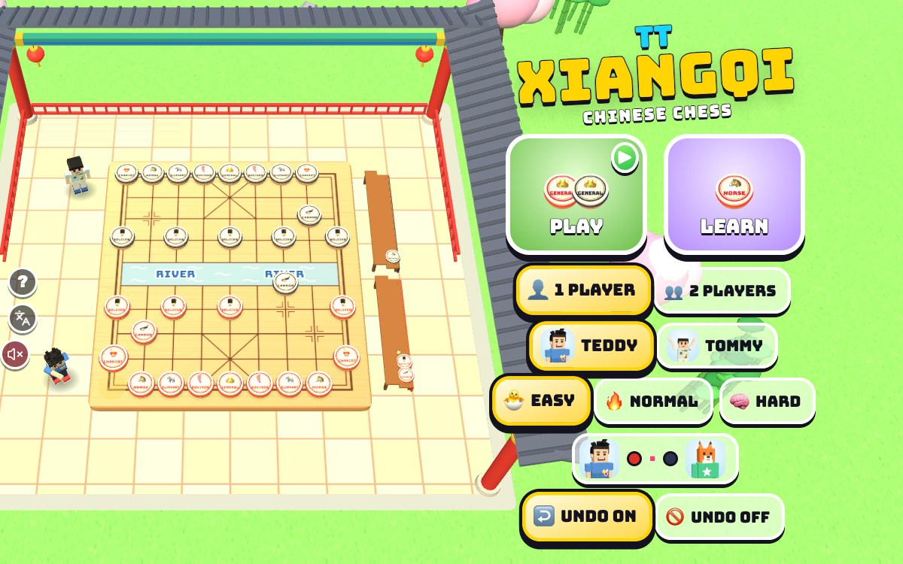](https://adong.github.io/xiangqi-tt/) | 🏮 **TT Xiangqi**: Chinese chess in a garden pavilion: play Foxy (Easy, Normal or Hard) or each other, plus a lesson for every piece. 花园亭子里的 3D 中国象棋：和电脑朋友 Foxy 下（简单、普通、困难）或两人对下，还有每个棋子一节小课。 | [play](https://adong.github.io/xiangqi-tt/) | [adong/xiangqi-tt](https://github.com/adong/xiangqi-tt) |
| [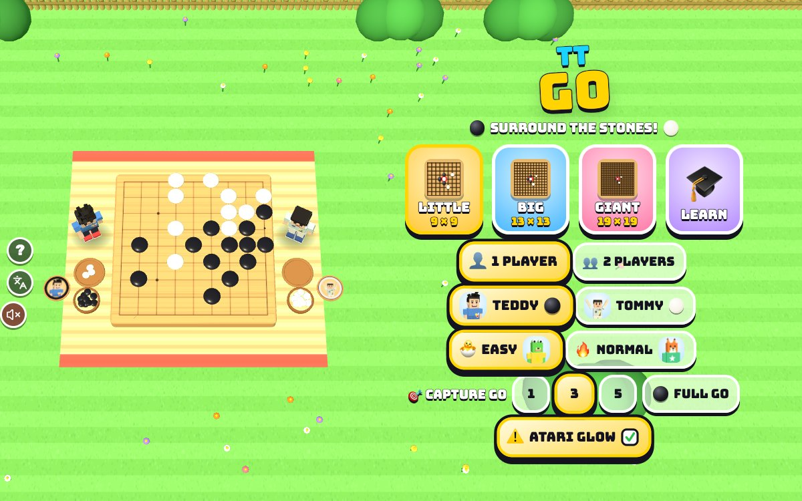](https://adong.github.io/go-tt/) | ⚪ **TT Go**: Go on a garden board: start with Capture Go, then play the whole game with counting, and learn liberties, atari and eyes. 花园里的围棋：先玩吃子棋，再下完整围棋数子，还能学气、提子、打吃和两只眼。 | [play](https://adong.github.io/go-tt/) | [adong/go-tt](https://github.com/adong/go-tt) |
| [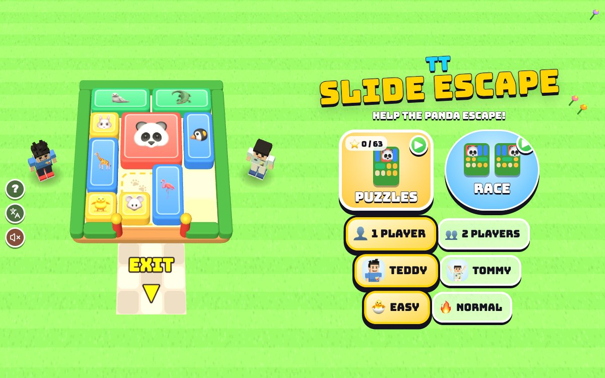](https://adong.github.io/klotski-tt/) | 🔳 **TT Slide Escape**: The classic sliding-block escape: slide the blocks so the big panda gets out of the gate. 42 levels and a race mode. 华容道：移动方块，让曹操从出口逃出去。42 关，还有比赛模式。 | [play](https://adong.github.io/klotski-tt/) | [adong/klotski-tt](https://github.com/adong/klotski-tt) |
| [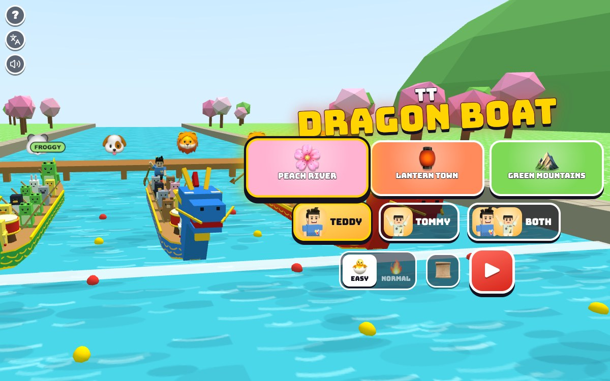](https://adong.github.io/dragon-boat-tt/) | 🚣 **TT Dragon Boat**: A Dragon Boat Festival race: drum and row in rhythm, dodge rocks, grab zongzi for speed and beat the other boats. 赛龙舟：端午节到了！跟着鼓声划船，绕开石头，吃粽子加速，看谁先到终点。 | [play](https://adong.github.io/dragon-boat-tt/) | [adong/dragon-boat-tt](https://github.com/adong/dragon-boat-tt) |
| [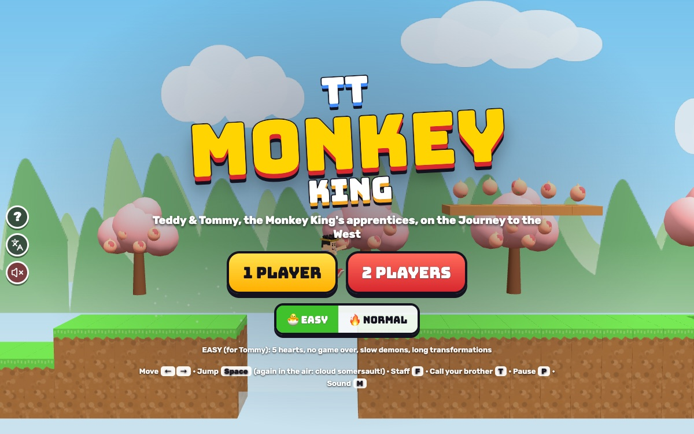](https://adong.github.io/monkey-king-tt/) | 🐒 **TT Monkey King**: A side-scrolling Journey to the West: swing a golden staff that grows, cloud-somersault and turn into a bird, fish or rock, from Flower Fruit Mountain to the Flaming Mountains. 1 or 2 players. 西游记闯关：Teddy 和 Tommy 是孙悟空的小徒弟，挥金箍棒、翻筋斗云、七十二变，从花果山一路闯到火焰山。单人或双人。 | [play](https://adong.github.io/monkey-king-tt/) | [adong/monkey-king-tt](https://github.com/adong/monkey-king-tt) |
|  | 🐀 **TT Zodiac Race**: The Great Race of the Chinese zodiac: pick one of the twelve animals and race the others across the river to the Jade Emperor's palace, each with its own power from the story. 十二生肖大赛跑：选一个生肖，骑着它游过大河，跑到玉皇大帝的宫殿！老鼠骑牛，龙会飞，老虎游得快；还能查一查全家人属什么。 | [play](https://adong.github.io/zodiac-race-tt/) | [adong/zodiac-race-tt](https://github.com/adong/zodiac-race-tt) |
|  | 🥁 **TT Lion Dance**: A lion dance rhythm game: Teddy is the head and Tommy the tail. Hit the drums, cymbals and gong on the beat and the lion dances across the plum-blossom poles. 舞狮节奏游戏：Teddy 当狮头，Tommy 当狮尾，跟着锣鼓敲鼓、打镲、敲锣，让狮子跳过梅花桩，最后采青。 | [play](https://adong.github.io/lion-dance-tt/) | [adong/lion-dance-tt](https://github.com/adong/lion-dance-tt) |
| [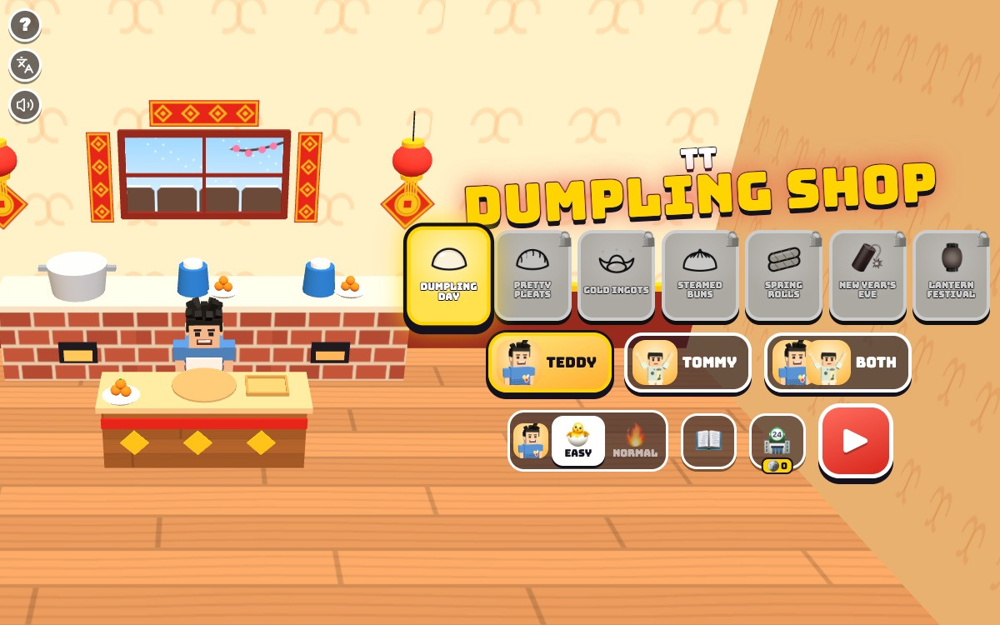](https://adong.github.io/dumplings-tt/) | 🥟 **TT Dumpling Shop**: A New Year dumpling shop: read the picture orders, roll, fill and fold the dumplings, then boil, steam or fry them for the zodiac animals. Tangyuan, buns and spring rolls come later. 包饺子：开一家小饺子店，看图片点菜，擀皮、放馅、包好，再煮、蒸或炸给十二生肖客人；后面还有汤圆、包子和春卷。 | [play](https://adong.github.io/dumplings-tt/) | [adong/dumplings-tt](https://github.com/adong/dumplings-tt) |
| [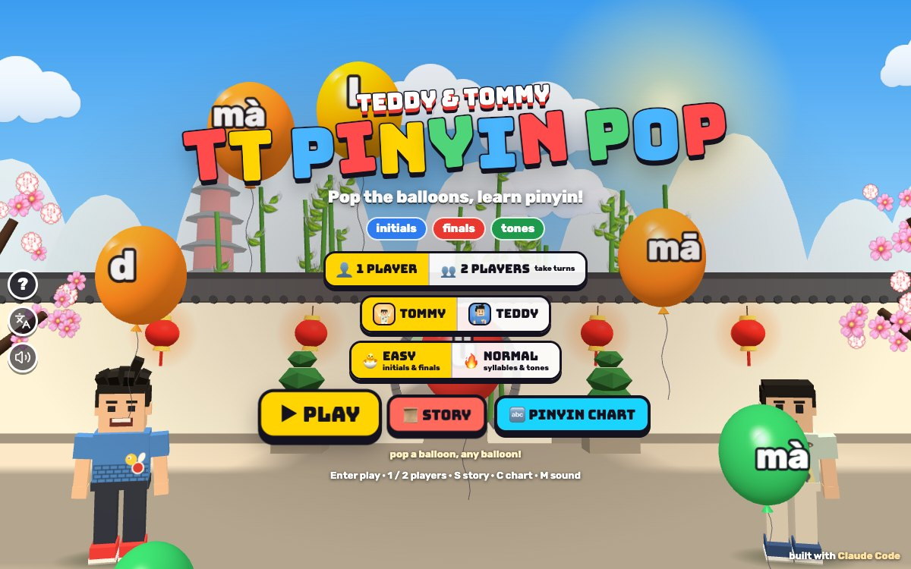](https://adong.github.io/pinyin-pop-tt/) | 🔤 **TT Pinyin Pop**: Pop the pinyin balloons in a Chinese courtyard: Tommy pops initials and finals, Teddy whole syllables and tones, with a picture for every word and the word said out loud. 戳气球学拼音：Tommy 戳声母和韵母，Teddy 戳整个音节和声调，每个词都有图片，还会读出来。 | [play](https://adong.github.io/pinyin-pop-tt/) | [adong/pinyin-pop-tt](https://github.com/adong/pinyin-pop-tt) |
| [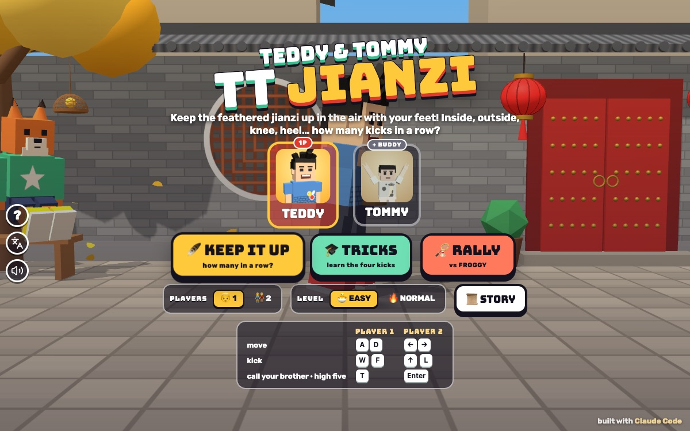](https://adong.github.io/jianzi-tt/) | 🪶 **TT Jianzi**: Kick the shuttlecock in an old Beijing courtyard: time your kicks with the inside, outside, knee or heel, learn tricks and pass it between brothers. 踢毽子：在北京小院里看准时机，用脚内侧、脚外侧、膝盖或脚后跟把毽子踢起来，学花样，兄弟俩传毽子。 | [play](https://adong.github.io/jianzi-tt/) | [adong/jianzi-tt](https://github.com/adong/jianzi-tt) |
|  | 🀄 **TT Tile Link**: Link matching mahjong-style tiles with a line of up to two turns, in zodiac, China, fruit and animal sets. Play alone, or race Froggy, Foxy or your brother. 连连看：找到两张一样的牌，用最多转两个弯的线连起来。十二生肖、中国、水果、动物四套牌，可以和 Froggy、Foxy 或兄弟比赛。 | [play](https://adong.github.io/tile-link-tt/) | [adong/tile-link-tt](https://github.com/adong/tile-link-tt) |
| [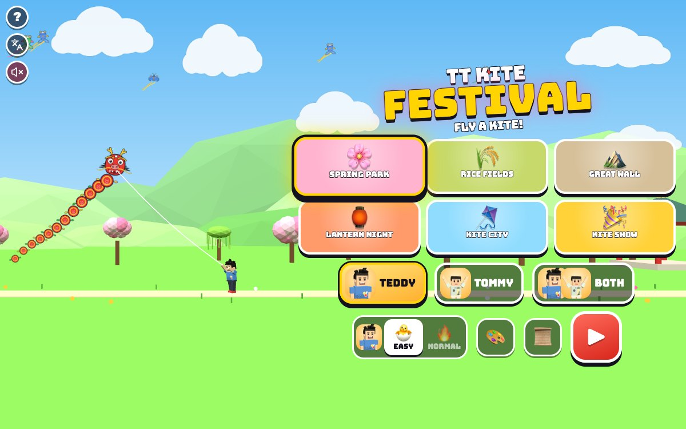](https://adong.github.io/kite-tt/) | 🪁 **TT Kite Festival**: Make a dragon, swallow, butterfly or goldfish kite, run into the wind to launch it, then let out the string to catch stars and lanterns. The brothers can fly together. 放风筝：做一只龙、燕子、蝴蝶或金鱼风筝，迎着风跑起来，放线飞上天，接住星星和灯笼。兄弟俩可以一起放。 | [play](https://adong.github.io/kite-tt/) | [adong/kite-tt](https://github.com/adong/kite-tt) |
| [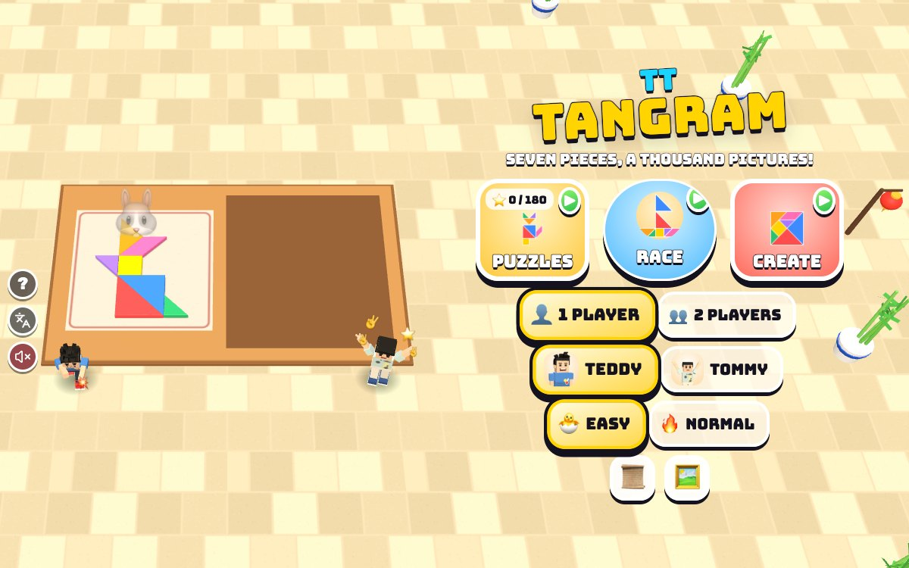](https://adong.github.io/tangram-tt/) | 🔷 **TT Tangram**: Drag, turn and flip the seven tangram pieces to fill a shadow: 60 pictures with all twelve zodiac animals, a race mode and a mat for your own designs. 七巧板：拖动、旋转、翻转七块板，把影子填满。60 幅图，包括十二生肖，还能比赛，也能自己创作。 | [play](https://adong.github.io/tangram-tt/) | [adong/tangram-tt](https://github.com/adong/tangram-tt) |
| [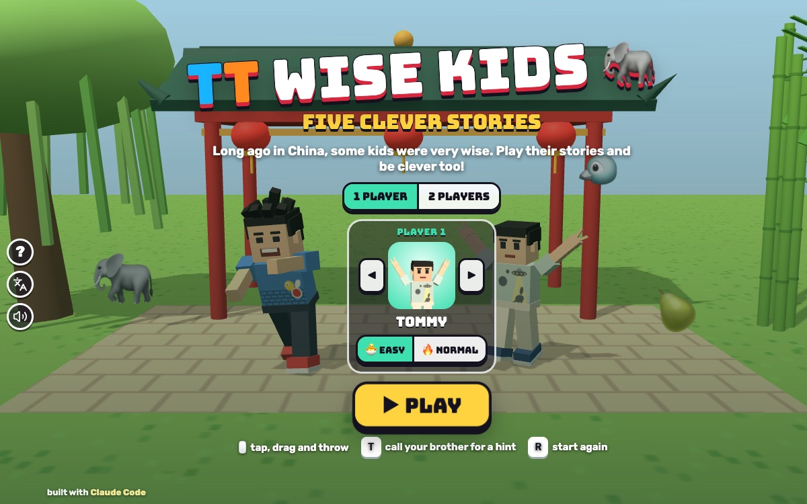](https://adong.github.io/wise-kids-tt/) | 🐘 **TT Wise Kids**: Five classic Chinese stories, each a picture book and then three puzzles: weigh the elephant, the thirsty crow, the broken vat, the horse race and sharing the pears. 聪明小故事：曹冲称象、乌鸦喝水、司马光砸缸、田忌赛马、孔融让梨，每个故事先看图画书，再闯三关。 | [play](https://adong.github.io/wise-kids-tt/) | [adong/wise-kids-tt](https://github.com/adong/wise-kids-tt) |
| [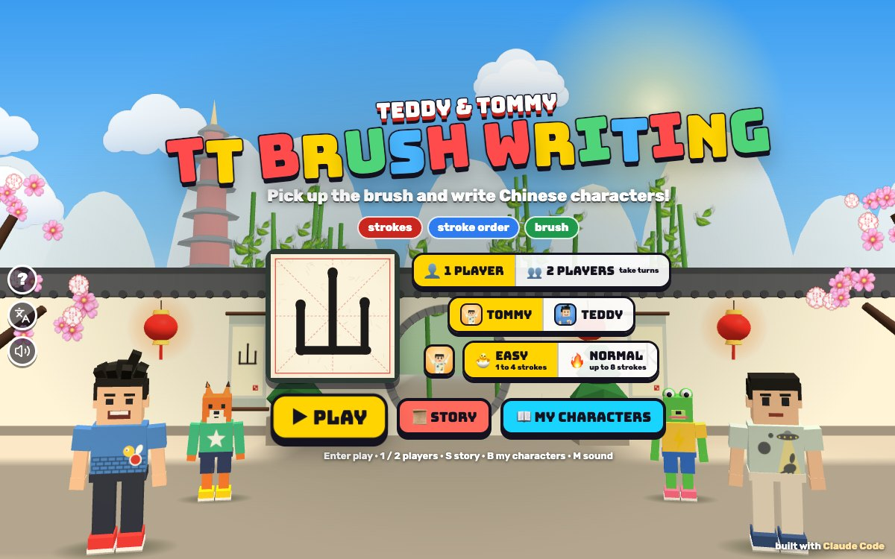](https://adong.github.io/calligraphy-tt/) | 🖌️ **TT Brush Writing**: Write Chinese characters with a brush in stroke order, from one, two and three to mountain, water and fire, with a red seal and a star for each one and a picture card that says it out loud. 写汉字：拿起毛笔按笔顺一笔一画描红，从一、二、三写到山、水、火，写对了盖红印章、得星星，每个字都有图片卡。 | [play](https://adong.github.io/calligraphy-tt/) | [adong/calligraphy-tt](https://github.com/adong/calligraphy-tt) |
| [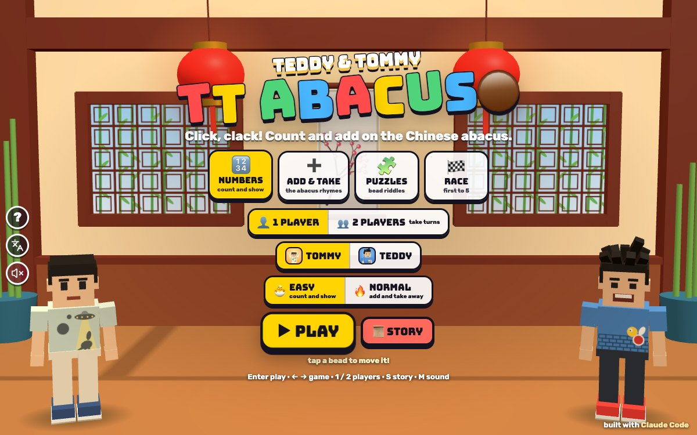](https://adong.github.io/abacus-tt/) | 🟤 **TT Abacus**: Learn the abacus in an old Chinese shop: Tommy counts and sets numbers, Teddy adds and subtracts with carrying and borrowing, plus bead puzzles and an abacus race. 学打算盘：Tommy 数一数、摆数字，Teddy 用口诀算加减，还有珠子谜题和算盘比赛。 | [play](https://adong.github.io/abacus-tt/) | [adong/abacus-tt](https://github.com/adong/abacus-tt) |
| [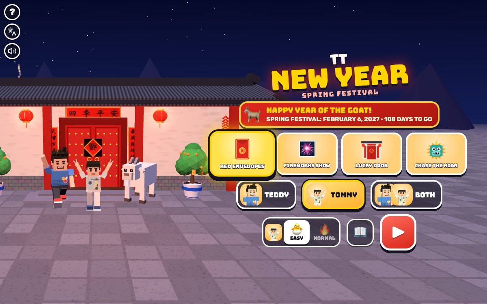](https://adong.github.io/new-year-tt/) | 🧧 **TT New Year**: Four Spring Festival games on New Year's Eve: catch red envelopes, design a fireworks show, hang couplets and the upside-down good-luck sign, and scare the Nian away with drums, lanterns and firecrackers. 春节小游戏：接红包、设计烟花秀、贴春联和倒着的福字，再敲鼓、亮灯笼、放鞭炮，把年兽吓跑！ | [play](https://adong.github.io/new-year-tt/) | [adong/new-year-tt](https://github.com/adong/new-year-tt) |
|  | 🥮 **TT Moon Festival**: The Mid-Autumn Festival under the full moon: bake mooncakes for the guests, guess the lantern riddles, then hop up to the moon to meet Chang'e and the Jade Rabbit. 中秋节：给客人做月饼，在灯笼下猜灯谜，再一路跳上月亮去见嫦娥和玉兔！ | [play](https://adong.github.io/moon-festival-tt/) | [adong/moon-festival-tt](https://github.com/adong/moon-festival-tt) |
| [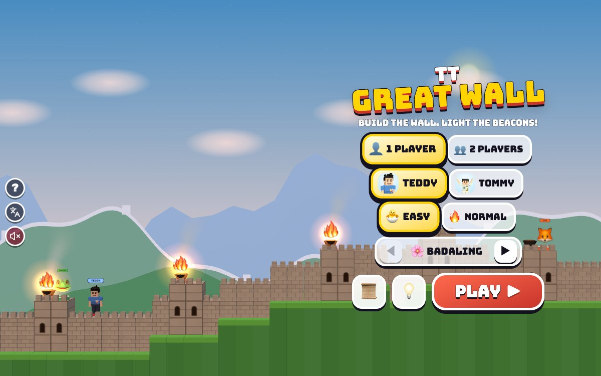](https://adong.github.io/great-wall-tt/) | 🏯 **TT Great Wall**: Build five real stretches of the Great Wall, from the sea at Shanhaiguan to the desert at Jiayuguan, then light the beacon towers one by one at dusk. 1 or 2 players. 修长城，点烽火！把城墙、烽火台和台阶拼进山脊上的空位，修好五段长城，天黑了再一座接一座点亮烽火台。单人或双人。 | [play](https://adong.github.io/great-wall-tt/) | [adong/great-wall-tt](https://github.com/adong/great-wall-tt) |
| [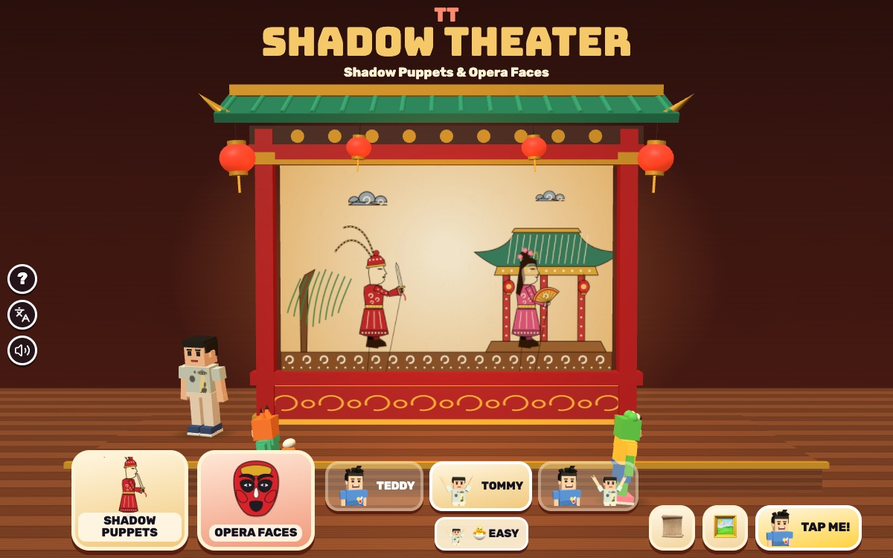](https://adong.github.io/shadow-theater-tt/) | 🎭 **TT Shadow Theater**: Build shadow puppets and put on a show behind a lamp-lit screen, then paint Beijing opera faces and learn what each colour says about a character. 做皮影，在幕布后面演皮影戏，录下来放给大家看；再给京剧脸谱涂颜色，学一学每种颜色代表什么样的人。 | [play](https://adong.github.io/shadow-theater-tt/) | [adong/shadow-theater-tt](https://github.com/adong/shadow-theater-tt) |
|  | 🎴 **TT Mahjong Junior**: A simple family mahjong: learn the tiles, make chows, pungs and a pair, and shout HÚ! Play Foxy, Panda and Froggy, or both brothers at one table. No money, just points. 小麻将：认识麻将牌，凑吃、碰和一个对子，就喊“胡”！和 Foxy、Panda、Froggy 一起玩，或者兄弟俩一起上桌。不玩钱，只玩分数。 | [play](https://adong.github.io/mahjong-junior-tt/) | [adong/mahjong-junior-tt](https://github.com/adong/mahjong-junior-tt) |

### 💥 Action & Adventure / 动作冒险 (14)

| | Game | Play | Code |
|---|---|---|---|
|  | 🚇 **Metro Surfer**: Run the subway tracks, dodge trains, grab coins and spell words. Call your brother to keep you safe. 在地铁轨道上奔跑：躲火车、捡金币、拼单词。叫兄弟来保护你。 | [play](https://adong.github.io/metro-surfer/) | [adong/metro-surfer](https://github.com/adong/metro-surfer) |
|  | 🥊 **King of Bonk!**: A cartoon backyard fight: Teddy's jab-straight vs Tommy's peace wave. 1 or 2 players. 后院卡通大乱斗：Teddy 的刺拳直拳对 Tommy 的和平波。单人或双人。 | [play](https://adong.github.io/king-of-bonk/) | [adong/king-of-bonk](https://github.com/adong/king-of-bonk) |
|  | 🍄 **TNT Brothers**: A side-scrolling platformer: jump, stomp zombies and reach the flag. 10 levels, 1 or 2 players. 横版闯关：跳跃、踩僵尸、冲到旗杆。10 关，单人或双人。 | [play](https://adong.github.io/tnt-brothers/) | [adong/tnt-brothers](https://github.com/adong/tnt-brothers) |
|  | 🧟 **Brothers vs Zombies**: Defend the backyard cookies from silly zombies with hoops, ice-cream stands and ✌️ shooters. 15 levels. 用篮筐、冰淇淋摊和 ✌️ 发射器挡住捣蛋僵尸，保卫后院的饼干。15 关。 | [play](https://adong.github.io/brothers-vs-zombies/) | [adong/brothers-vs-zombies](https://github.com/adong/brothers-vs-zombies) |
|  | 🛏️ **Double TTrouble**: A brothers street brawl with pillows: silly and safe. 6 stages, 1 or 2 players. 兄弟俩的枕头街头大战，搞笑又安全。6 关，单人或双人。 | [play](https://adong.github.io/brawler-tt/) | [adong/brawler-tt](https://github.com/adong/brawler-tt) |
|  | ❄️ **SnowbaTTle**: Snowball fight! Teddy vs Tommy behind snow forts, or team up against the snowmen. 1 or 2 players. 打雪仗：Teddy 对 Tommy 躲在雪堡后面，或者组队打雪人。单人或双人。 | [play](https://adong.github.io/snowball-fight-tt/) | [adong/snowball-fight-tt](https://github.com/adong/snowball-fight-tt) |
|  | 🪖 **JuggernauT**: A classic run-and-gun: six missions, silly rides, friends to rescue, and zombie, mummy, monkey, chubby and snowman transformations. 1 or 2 players. 经典横版射击闯关：6 个任务、搞笑坐骑、解救朋友，还会变成僵尸、木乃伊、猴子、小胖子和雪人。单人或双人。 | [play](https://adong.github.io/juggernaut/) | [adong/juggernaut](https://github.com/adong/juggernaut) |
|  | 🛡️ **Heroes TT**: A kid-sized team battle arena: two lanes, towers and a cookie castle to crumble. Team Teddy & Tommy vs a silly Zombie & Robot team. 1 or 2 players. 儿童版团队对战竞技场：两条路、防御塔和饼干城堡。Teddy & Tommy 队对战搞笑的僵尸机器人队。单人或双人。 | [play](https://adong.github.io/heroes-tt/) | [adong/heroes-tt](https://github.com/adong/heroes-tt) |
|  | 🌻 **TT Garden Defense**: Tower defense in the garden: place toy towers to stop snack-stealing critters, who only get soaked or sleepy. 15 levels. 花园保卫战：放玩具塔挡住偷零食的小动物，它们只会被淋湿或睡着。15 关。 | [play](https://adong.github.io/garden-defense-tt/) | [adong/garden-defense-tt](https://github.com/adong/garden-defense-tt) |
| [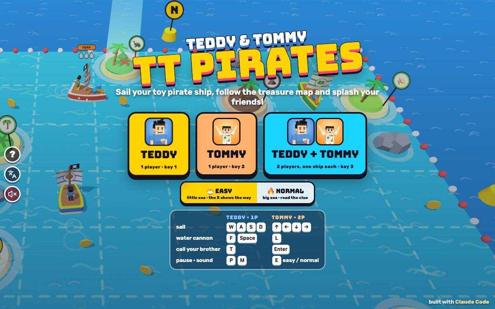](https://adong.github.io/pirates-tt/) | 🏴‍☠️ **TT Pirates**: Captain a toy pirate ship: read the treasure map's north, east, south and west, dig up treasure and soak your friends' ships with a water cannon. 1 or 2 players. 海盗船：看懂藏宝地图上的东南西北，找到宝藏，用水炮把朋友们的船喷湿。单人或双人。 | [play](https://adong.github.io/pirates-tt/) | [adong/pirates-tt](https://github.com/adong/pirates-tt) |
| [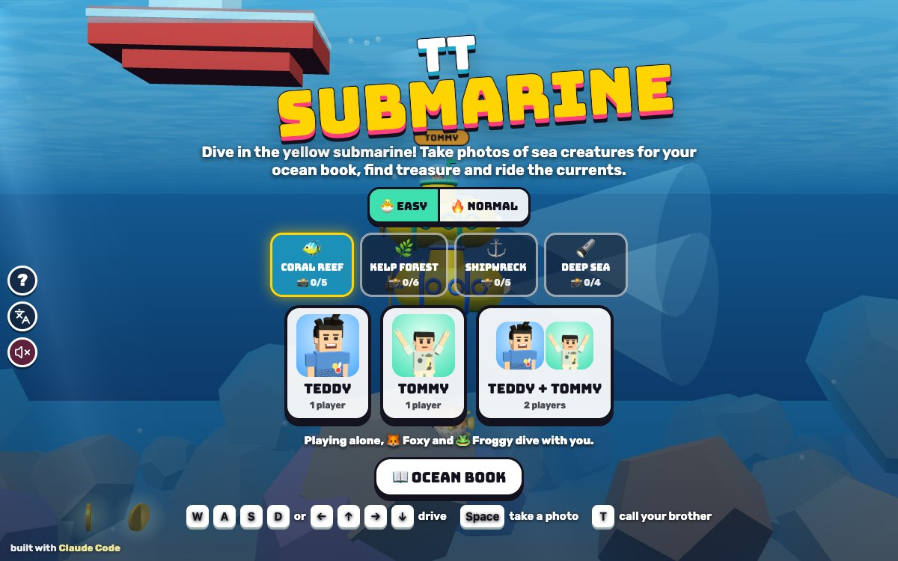](https://adong.github.io/submarine-tt/) | 🐙 **TT Submarine**: Explore a coral reef, a kelp forest, a shipwreck and the deep sea in a yellow submarine: photograph 20 sea creatures for your ocean book and find treasure. 潜水艇探险：给海洋动物拍照放进图鉴，找宝藏，躲开洋流。4 个潜水点，20 种动物。 | [play](https://adong.github.io/submarine-tt/) | [adong/submarine-tt](https://github.com/adong/submarine-tt) |
| [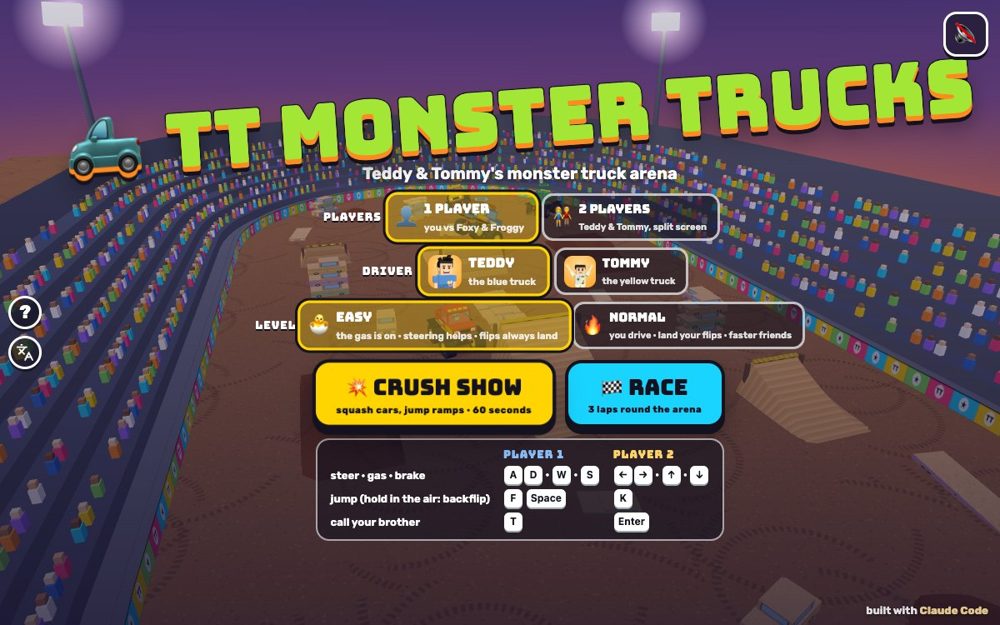](https://adong.github.io/monster-truck-tt/) | 🛻 **TT Monster Trucks**: Huge bouncy monster trucks in a packed arena: squash cardboard cars, fly off ramps, land backflips, or race three laps. Play Foxy and Froggy, or each other. 怪兽卡车：在竞技场里压扁纸板汽车、冲坡跳跃、后空翻，或者绕场赛车三圈。 | [play](https://adong.github.io/monster-truck-tt/) | [adong/monster-truck-tt](https://github.com/adong/monster-truck-tt) |
|  | 🚒 **TT Firefighters**: Drive the fire truck, raise the ladder and spray out the silly googly-eyed fires, then rescue the kittens and collect a safety card for every street. 消防员：开消防车，升起梯子，喷水灭掉会做鬼脸的火，救下小猫，每条街都能拿到一张安全卡片。 | [play](https://adong.github.io/firefighter-tt/) | [adong/firefighter-tt](https://github.com/adong/firefighter-tt) |
|  | 🦖 **TT Dino Safari**: A photo safari through a dinosaur valley: frame 12 kinds of dinosaur from the jeep, earn stars for great shots and fill your dino book with fun facts. 恐龙探险：坐吉普车穿过恐龙山谷，给 12 种恐龙拍照，拍得好就得星星，每张照片都附带恐龙小知识。 | [play](https://adong.github.io/dino-safari-tt/) | [adong/dino-safari-tt](https://github.com/adong/dino-safari-tt) |

### 🕹️ Arcade Classics / 街机经典 (47)

| | Game | Play | Code |
|---|---|---|---|
|  | 🐦 **FlaTTy Birds**: Tap to flap between stacked trains and station pillars. Call your brother to fly beside you. 点一下就扇翅膀，穿过叠起来的火车和站台柱子。叫兄弟来陪你一起飞。 | [play](https://adong.github.io/flatty-birds/) | [adong/flatty-birds](https://github.com/adong/flatty-birds) |
|  | 🍉 **FruiTTy Kids**: Swipe to slice flying fruit. Watch out for the zombie bombs, and call your brother as a second chef. 划一下，切开飞起来的水果。小心僵尸炸弹，叫兄弟来当第二个大厨。 | [play](https://adong.github.io/fruitty-kids/) | [adong/fruitty-kids](https://github.com/adong/fruitty-kids) |
|  | 💥 **Angry TNT**: Slingshot Teddy and Tommy at wobbly zombie towers. 15 levels. 用弹弓把 Teddy 和 Tommy 弹向摇摇晃晃的僵尸塔。15 关。 | [play](https://adong.github.io/angry-tnt/) | [adong/angry-tnt](https://github.com/adong/angry-tnt) |
|  | 💣 **BombasTTic!**: Maze bombs and power-ups: 12 stages, team up, or battle Teddy vs Tommy. 1 or 2 players. 迷宫炸弹和道具：12 关冒险，可以组队，也可以 Teddy 对 Tommy 对战。单人或双人。 | [play](https://adong.github.io/bomber-teddy/) | [adong/bomber-teddy](https://github.com/adong/bomber-teddy) |
|  | 🚦 **HoppiTTy Hop**: Hop across roads, rivers and subway tracks without getting squished. 跳过马路、小河和地铁轨道，别被压扁啦。 | [play](https://adong.github.io/crossy-teddy/) | [adong/crossy-teddy](https://github.com/adong/crossy-teddy) |
|  | 🏢 **100 Floors**: Drop down 100 floors, or climb up 100: how far can you go? 是男人就下一百层，还有上一百层：你能走多远？ | [play](https://adong.github.io/hundred-floors/) | [adong/hundred-floors](https://github.com/adong/hundred-floors) |
|  | 🍒 **WaTTermelon**: Drop and merge fruit, all the way up to a giant watermelon. 合成大西瓜：丢水果、合水果，一路合成大西瓜。 | [play](https://adong.github.io/merge-teddy/) | [adong/merge-teddy](https://github.com/adong/merge-teddy) |
|  | ⛄ **Snow TT Bros**: Snow the zombies into giant snowballs and roll them away. 20 floors, 1 or 2 players. 把僵尸冻成大雪球，滚起来撞倒一大片！20 层，单人或双人。 | [play](https://adong.github.io/snow-tt-bros/) | [adong/snow-tt-bros](https://github.com/adong/snow-tt-bros) |
|  | 🫧 **Bubble TT**: Trap zombies in bubbles and pop them together. 30 levels, 1 or 2 players. 吹泡泡困住僵尸，再一起戳破！30 关，单人或双人。 | [play](https://adong.github.io/bubble-tt/) | [adong/bubble-tt](https://github.com/adong/bubble-tt) |
|  | 🚜 **Tank TT**: Two tanks guard the cookie jar from zombie tanks. 16 stages, 1 or 2 players, and you can build your own maps. 两辆坦克守护饼干罐，打退僵尸坦克。16 关，单人或双人，还能自己画地图。 | [play](https://adong.github.io/tank-tt/) | [adong/tank-tt](https://github.com/adong/tank-tt) |
|  | ✈️ **Sky TT**: A classic plane shooter: fly a toy plane, bonk zombie blimps and bosses, and call your brother as a wingman. 10 stages, 1 or 2 players. 经典飞机射击：开着玩具飞机打僵尸飞艇和大魔王，叫兄弟来当僚机。10 关，单人或双人。 | [play](https://adong.github.io/sky-tt/) | [adong/sky-tt](https://github.com/adong/sky-tt) |
| [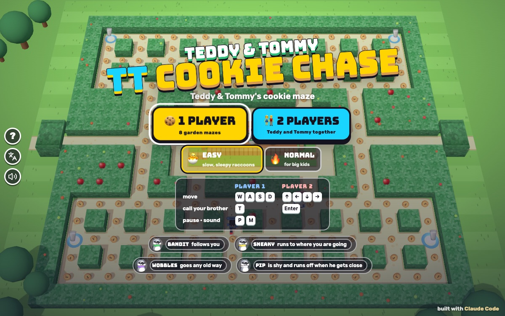](https://adong.github.io/cookie-chase-tt/) | 🍪 **TT Cookie Chase**: A garden maze full of cookies: dodge four cheeky raccoons, drink milk to make them sleepy. 8 mazes, 1 player or both brothers together. 花园迷宫里吃饼干：躲开四只调皮的浣熊，喝牛奶让它们犯困。8 个迷宫，单人或兄弟俩一起玩。 | [play](https://adong.github.io/cookie-chase-tt/) | [adong/cookie-chase-tt](https://github.com/adong/cookie-chase-tt) |
| [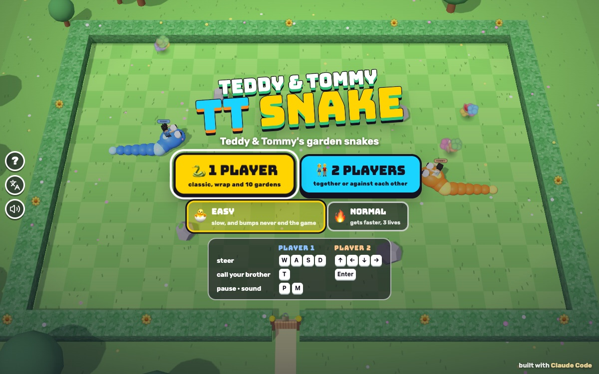](https://adong.github.io/snake-tt/) | 🐍 **TT Snake**: A garden snake game: Teddy and Tommy ride friendly snakes and eat fruit to grow. Classic, wrap-around and 10 garden levels, 1 or 2 players. 花园贪吃蛇：Teddy 和 Tommy 骑着蛇吃水果长尾巴；经典、穿墙和 10 个闯关花园，单人或双人。 | [play](https://adong.github.io/snake-tt/) | [adong/snake-tt](https://github.com/adong/snake-tt) |
|  | 🧱 **Brick Bonk**: Bounce the ball off a trampoline and bonk every toy brick: 18 levels, power-ups, and two paddles for 2 players. 打砖块！把蹦床举过头顶，把球弹上去撞掉所有积木。18 关，有道具，单人或双人。 | [play](https://adong.github.io/brick-bonk/) | [adong/brick-bonk](https://github.com/adong/brick-bonk) |
|  | 🌀 **TT Pinball**: 3D pinball: flip the ball up ramps, into bumpers and targets, with multiball, on Space, Jungle and Candy tables. 3D 弹珠台：用挡板把弹珠打上坡道、撞弹跳柱、打倒靶子，还有多球！太空、丛林、糖果三张台子。 | [play](https://adong.github.io/pinball-tt/) | [adong/pinball-tt](https://github.com/adong/pinball-tt) |
| [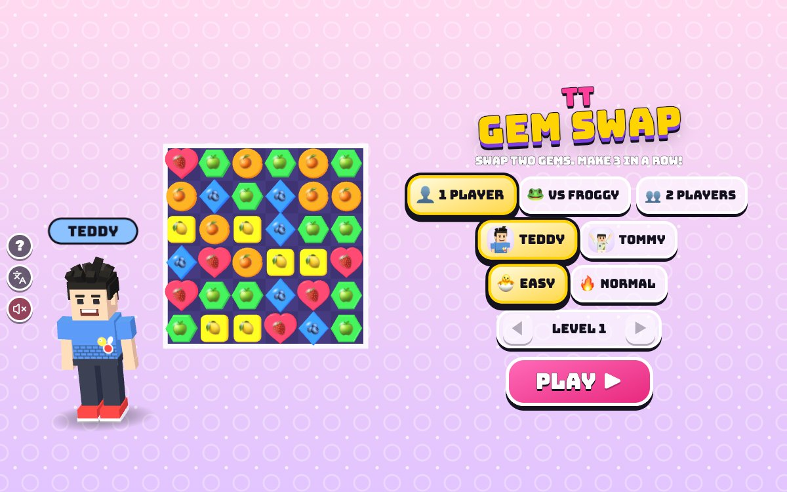](https://adong.github.io/gem-swap-tt/) | 💎 **TT Gem Swap**: Swap fruit gems to match three: chains, rockets, bombs and rainbow stars across 40 levels with goals. Play alone, or race Froggy, Foxy or your brother. 消消乐：换一换水果宝石，三个连成一排就消掉，还有连击、火箭、炸弹和彩虹星。40 关，可以和 Froggy、Foxy 或兄弟比分数。 | [play](https://adong.github.io/gem-swap-tt/) | [adong/gem-swap-tt](https://github.com/adong/gem-swap-tt) |
| [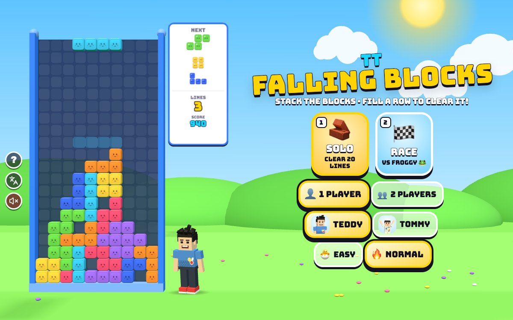](https://adong.github.io/falling-blocks-tt/) | 🟪 **TT Falling Blocks**: Slide and turn the falling block shapes to fill whole rows and clear them. Play alone, as a team, or race Foxy, Froggy or your brother. A slow EASY mode for Tommy. 方块消除：左右移动、旋转掉下来的方块，摆满一整行就消掉！一个人玩、兄弟组队，或者和 Foxy、Froggy、兄弟比赛。简单模式适合 Tommy。 | [play](https://adong.github.io/falling-blocks-tt/) | [adong/falling-blocks-tt](https://github.com/adong/falling-blocks-tt) |
| [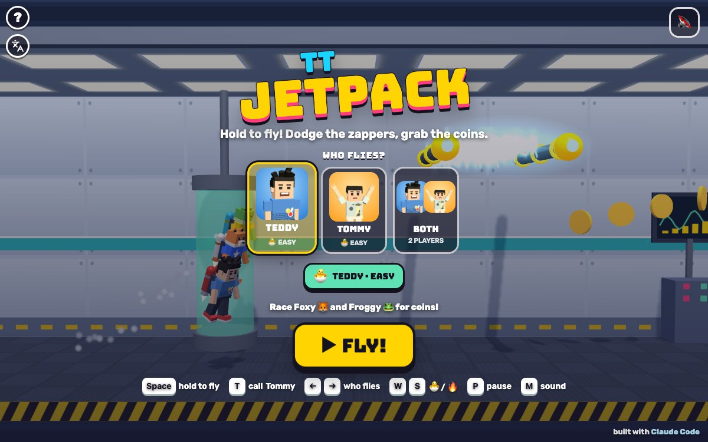](https://adong.github.io/jetpack-tt/) | ⚡ **TT Jetpack**: Hold to fly, let go to drop: zip through a science lab, dodge the zappers and grab coins all the way to the exit. Race Foxy and Froggy, or each other. 喷气背包：按住就飞，松开就掉，在实验室里躲开电网、抓金币，一路飞到出口。 | [play](https://adong.github.io/jetpack-tt/) | [adong/jetpack-tt](https://github.com/adong/jetpack-tt) |
|  | 👾 **TT Star Defenders**: Wobbly jelly aliens march down the screen: slide your toy cannon, fire star-pops from behind squishy shields and pop all 10 waves. 1 or 2 players. 星星保卫队：果冻外星人一排排走下来，推着玩具大炮躲在软软的护盾后面发射星星，把 10 波外星人都戳破。单人或双人。 | [play](https://adong.github.io/star-defenders-tt/) | [adong/star-defenders-tt](https://github.com/adong/star-defenders-tt) |
| [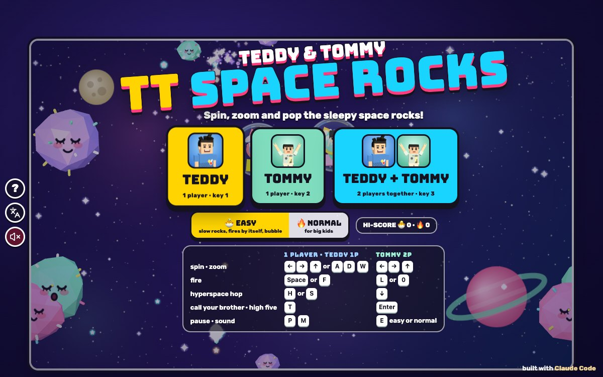](https://adong.github.io/space-rocks-tt/) | ☄️ **TT Space Rocks**: Spin and thrust a little toy rocket around a wrap-around starfield, break sleepy candy space rocks into smaller and smaller pieces, and warp to the next sector. 太空碎石：开着小飞船转一转、冲一冲，把爱睡觉的糖果陨石打成越来越小的碎片，清空星区就飞向下一关。 | [play](https://adong.github.io/space-rocks-tt/) | [adong/space-rocks-tt](https://github.com/adong/space-rocks-tt) |
| [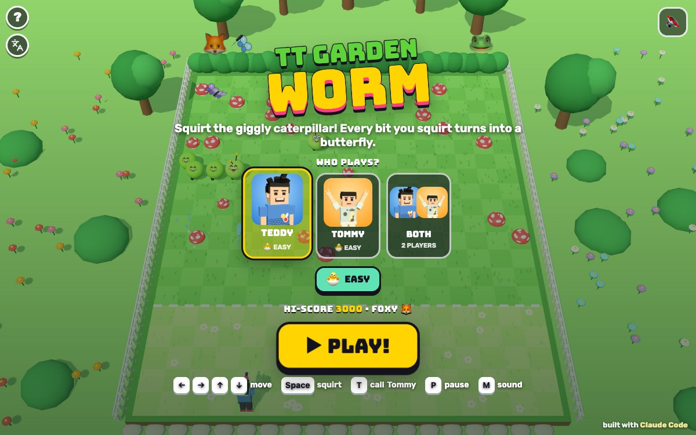](https://adong.github.io/garden-worm-tt/) | 🐛 **TT Garden Worm**: A giggling caterpillar winds down through the mushroom patch: squirt its segments into butterflies and watch it split in two. 1 or 2 players. 花园毛毛虫：咯咯笑的毛毛虫在蘑菇间爬下来，用水枪把它的每一节变成蝴蝶，喷中一节它就断成两条。单人或双人。 | [play](https://adong.github.io/garden-worm-tt/) | [adong/garden-worm-tt](https://github.com/adong/garden-worm-tt) |
| [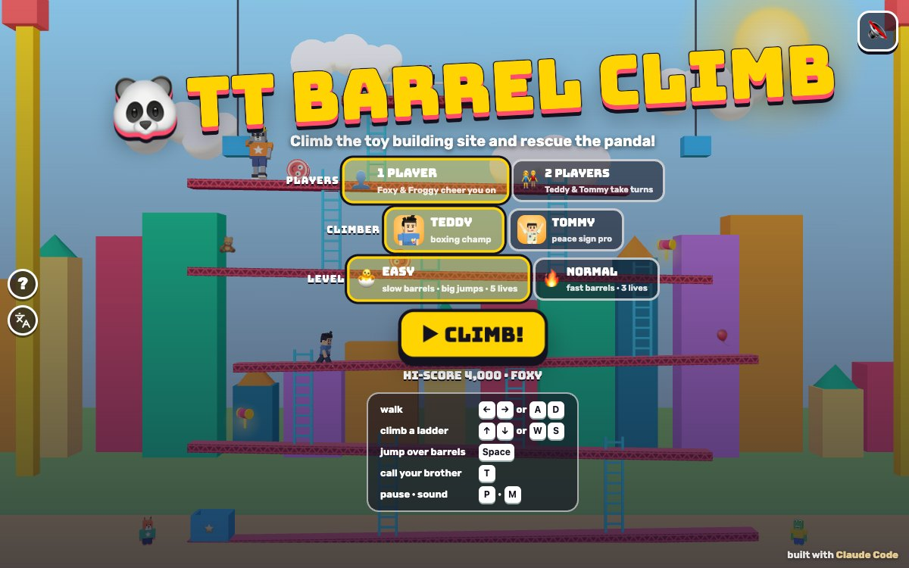](https://adong.github.io/barrel-climb-tt/) | 🐼 **TT Barrel Climb**: Climb the ladders and jump the bouncy barrels a cheeky raccoon rolls down the girders, grab the hammer, and rescue the panda at the top. 4 stages. 爬梯救熊猫：调皮的浣熊把木桶滚下钢梁，爬梯子、跳过木桶、拿锤子，爬到最上面救熊猫。4 种关卡轮流来。 | [play](https://adong.github.io/barrel-climb-tt/) | [adong/barrel-climb-tt](https://github.com/adong/barrel-climb-tt) |
|  | 🪏 **TT Digger**: Dig tunnels through the earth, puff the critters up until they float away like balloons, or drop a rock to flatten them like pancakes. 1 or 2 players. 挖地小英雄：挖地道，用打气筒把小怪吹成气球飘走，或者让石头掉下来把它们压成薄饼。单人或双人。 | [play](https://adong.github.io/digger-tt/) | [adong/digger-tt](https://github.com/adong/digger-tt) |
| [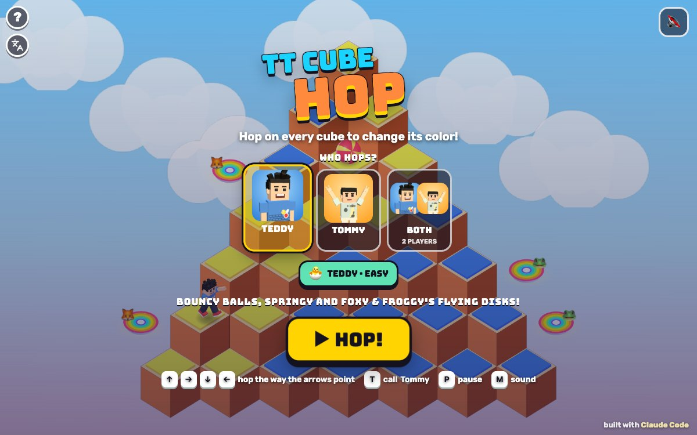](https://adong.github.io/cube-hop-tt/) | 🔶 **TT Cube Hop**: Hop around a pyramid of toy cubes and change every top to the target color, dodging bouncy balls and a springy snake. Ride a disk back to the top. 跳跳方块：在方块金字塔上跳来跳去，把每个方块的顶面变成目标颜色，躲开弹弹球和弹簧蛇，还能坐飞盘回到顶上。 | [play](https://adong.github.io/cube-hop-tt/) | [adong/cube-hop-tt](https://github.com/adong/cube-hop-tt) |
| [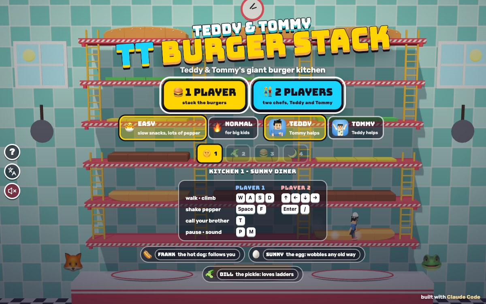](https://adong.github.io/burger-stack-tt/) | 🍔 **TT Burger Stack**: Walk across the buns, lettuce, cheese and patties to drop them floor by floor onto the plates, and pepper the silly snacks that chase you. 1 or 2 players. 汉堡大厨：走过每一层面包、生菜、芝士和肉饼，让它们一层层掉进盘子里叠成汉堡，撒胡椒让追你的零食打喷嚏。单人或双人。 | [play](https://adong.github.io/burger-stack-tt/) | [adong/burger-stack-tt](https://github.com/adong/burger-stack-tt) |
| [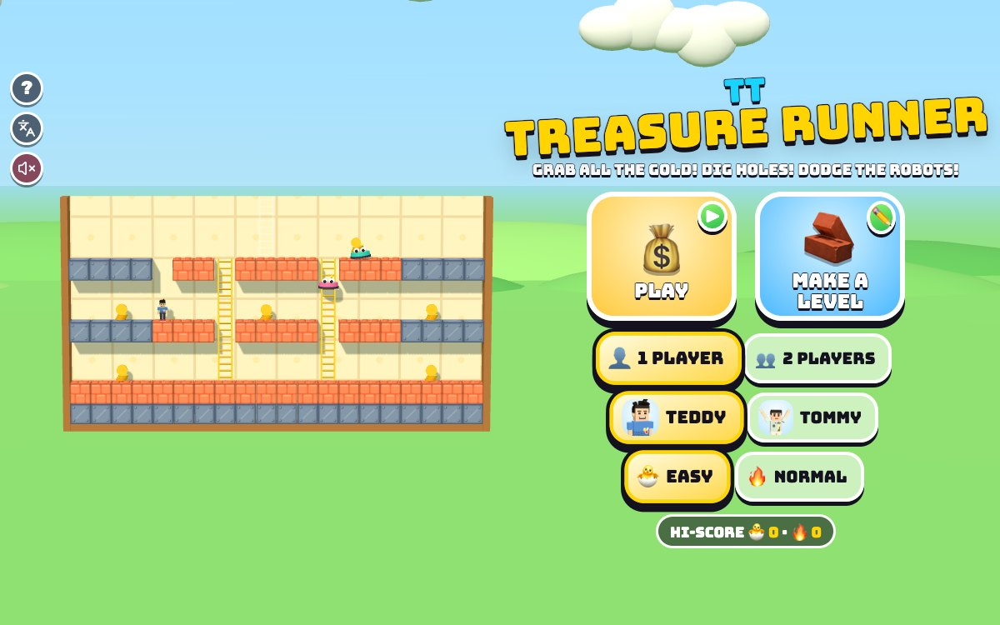](https://adong.github.io/treasure-runner-tt/) | 💰 **TT Treasure Runner**: Grab all the gold across ladders, bricks and monkey bars. You can't jump, but you can dig holes to trap the robot vacuums. 30 levels and a level maker. 寻宝跑跑：在梯子、砖块和单杠之间拿到所有金子。不能跳，但可以挖洞困住追你的机器人。30 关，还能自己做关卡。 | [play](https://adong.github.io/treasure-runner-tt/) | [adong/treasure-runner-tt](https://github.com/adong/treasure-runner-tt) |
|  | 🔵 **TT Bubble Shooter**: Aim the launcher and fire colored bubbles: match 3 or more to pop them, bounce shots off the walls, and clear the board before the ceiling comes down. 50 levels. 射泡泡：瞄准发射彩色泡泡，三个一样颜色的就消除，可以碰墙反弹，在天花板压下来之前全部清空。50 关。 | [play](https://adong.github.io/bubble-shooter-tt/) | [adong/bubble-shooter-tt](https://github.com/adong/bubble-shooter-tt) |
|  | 🚧 **TT Fence Builder**: Build fences across the field to claim it as your garden while a big beach ball bounces around, and uncover the hidden picture underneath. 围栏大作战：在空地上建围栏，把它变成你的花园，别让大皮球碰到还没建好的围栏，占够地就能看到下面藏着的图画。 | [play](https://adong.github.io/fence-builder-tt/) | [adong/fence-builder-tt](https://github.com/adong/fence-builder-tt) |
|  | 📰 **TT Paper Route**: Ride your bike up a sunny street and toss newspapers into the mailboxes, dodging sprinklers, skateboards and puppies, from Monday to Sunday. 送报小骑手：骑自行车沿着阳光大街送报纸，扔进信箱，躲开洒水器、滑板和小狗，从星期一送到星期天。 | [play](https://adong.github.io/paper-route-tt/) | [adong/paper-route-tt](https://github.com/adong/paper-route-tt) |
| [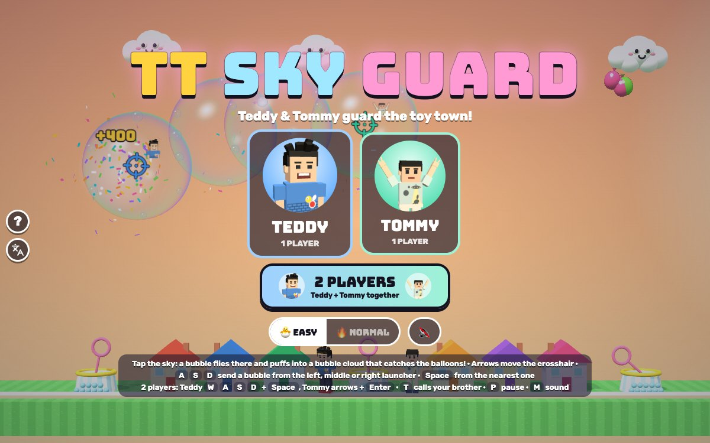](https://adong.github.io/sky-guard-tt/) | 🏘️ **TT Sky Guard**: Silly cloud critters drop paint balloons on a toy town: tap the sky to blow bubble clouds that catch them, and chain the catches. 10 waves. 天空守卫：云朵小怪往玩具小镇扔颜料气球，点一下天空吹出泡泡云接住它们，还能连锁接住更多。10 波。 | [play](https://adong.github.io/sky-guard-tt/) | [adong/sky-guard-tt](https://github.com/adong/sky-guard-tt) |
| [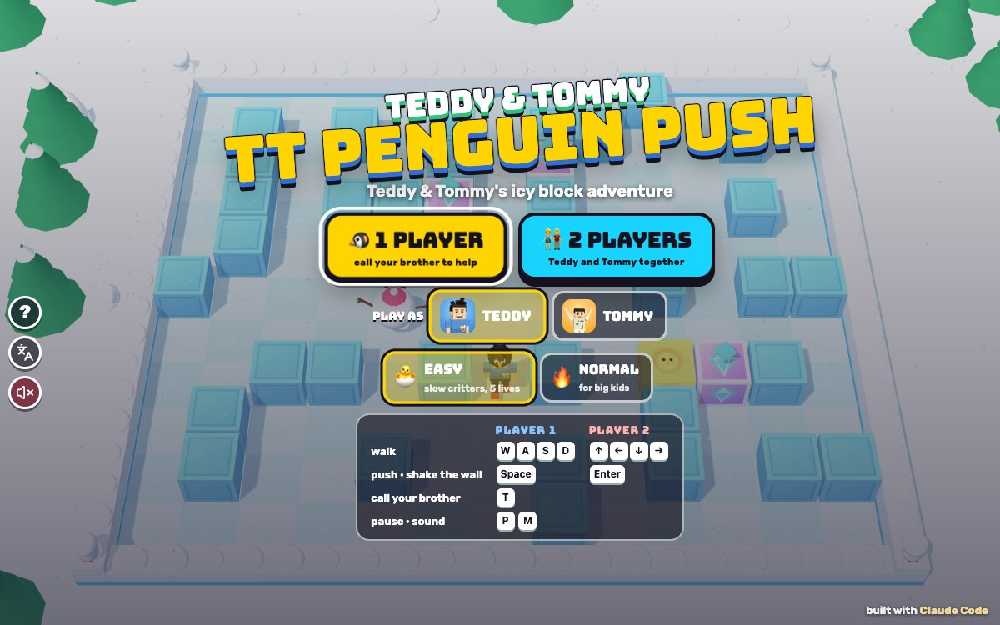](https://adong.github.io/penguin-push-tt/) | 🐧 **TT Penguin Push**: Waddle round an icy maze in penguin hats and push ice blocks that slide all the way, scooping up the grumpy snowball critters in their path. Line up three diamond blocks for a big bonus. 企鹅推冰块：戴上企鹅帽在冰场迷宫里推冰块，冰块一滑到底，把路上的雪球怪全都铲走。三个钻石冰块排成一排有大奖！ | [play](https://adong.github.io/penguin-push-tt/) | [adong/penguin-push-tt](https://github.com/adong/penguin-push-tt) |
|  | 🪂 **TT Balloon Bump**: Float over a sunny lake with two balloons on your back: flap to rise, then drop onto your rivals' balloons from above to pop them, and watch them parachute into the lake. 1 or 2 players. 气球碰碰：背着两个气球在湖上飞，从上面落到对手的气球上把它戳破，对手就打开降落伞掉进湖里游走。单人或双人。 | [play](https://adong.github.io/balloon-bump-tt/) | [adong/balloon-bump-tt](https://github.com/adong/balloon-bump-tt) |
| [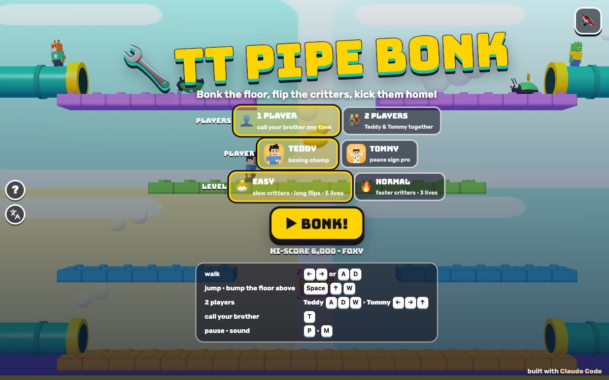](https://adong.github.io/pipe-bonk-tt/) | 🔧 **TT Pipe Bonk**: Silly bugs crawl out of the pipes: jump up under the floor to flip them over, then kick them back down the pipe. Hit the BOING block to flip them all. 1 or 2 players. 水管碰碰：小虫子从水管里爬出来，跳起来从下面顶地板把它翻过来，再把它踢回水管里。顶一下“嘣”方块，全都翻过来！单人或双人。 | [play](https://adong.github.io/pipe-bonk-tt/) | [adong/pipe-bonk-tt](https://github.com/adong/pipe-bonk-tt) |
|  | 🌕 **TT Moon Buggy**: Drive a bouncy six-wheeled buggy across a candy-colored moon from checkpoint A to Z: jump the craters, zap the boulders ahead and pop the space jellies overhead. 月球车：开着蹦蹦跳跳的六轮月球车从检查点 A 开到 Z，跳过陨石坑，打碎前面的大石头，戳破头上的太空果冻。 | [play](https://adong.github.io/moon-buggy-tt/) | [adong/moon-buggy-tt](https://github.com/adong/moon-buggy-tt) |
| [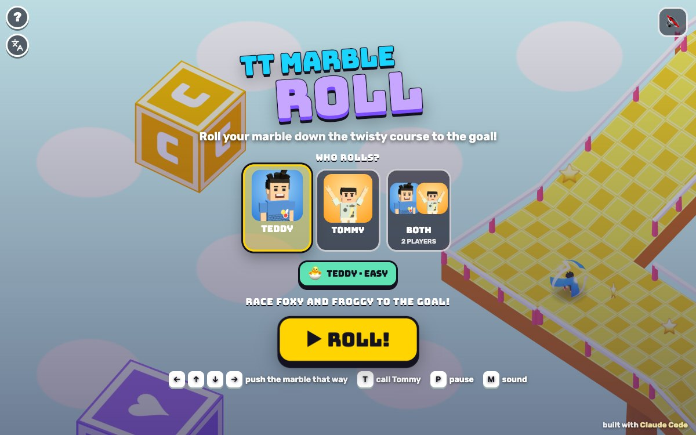](https://adong.github.io/marble-roll-tt/) | 🔮 **TT Marble Roll**: Roll a glass marble with your brother inside down twisty toy courses of ramps, funnels and wobbly bridges, grab the stars and reach the goal before time runs out. Race each other too. 弹珠滚滚：把装着兄弟的玻璃弹珠从弯弯的玩具赛道上滚下去，经过斜坡、漏斗和晃晃桥，捡星星，在时间用完前滚到终点。 | [play](https://adong.github.io/marble-roll-tt/) | [adong/marble-roll-tt](https://github.com/adong/marble-roll-tt) |
| [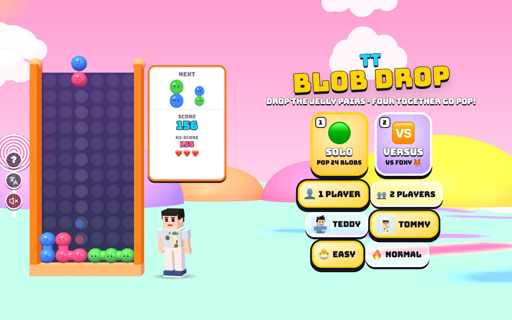](https://adong.github.io/blob-drop-tt/) | 🟢 **TT Blob Drop**: Giggling jelly blobs drop in pairs: slide and turn them so four of one color touch and pop, and chain the pops for big scores. Play alone, as a team, or head to head against Foxy, Froggy or your brother. 果冻消消：果冻两个一对掉下来，左右移动、旋转，同一种颜色四个连在一起就消除，连锁消除分数更高。可以单人、组队或对战。 | [play](https://adong.github.io/blob-drop-tt/) | [adong/blob-drop-tt](https://github.com/adong/blob-drop-tt) |
|  | 🧃 **TT Juice Bar**: Thirsty bunnies, giraffes, hippos and penguins crowd four counters: pour juice, slide the cups down, catch the empties as they come back and pick up the tips. 1 or 2 players. 果汁吧：口渴的小兔子、长颈鹿、河马和企鹅挤在四个柜台前，倒果汁、把杯子推出去，接住推回来的空杯子，还能捡小费。单人或双人。 | [play](https://adong.github.io/juice-bar-tt/) | [adong/juice-bar-tt](https://github.com/adong/juice-bar-tt) |
|  | 🏔️ **TT Ice Climb**: Climb a tall snowy mountain with a squeaky toy mallet: jump to break the ice overhead, hop up through the hole, ride the clouds, and grab the giant vegetable at the top. 8 mountains. 冰山攀登：拿着玩具锤子爬冰山，跳起来敲碎头上的冰块，从洞里跳上去，踩着云朵到山顶抓住大蔬菜。一共 8 座冰山。 | [play](https://adong.github.io/ice-climb-tt/) | [adong/ice-climb-tt](https://github.com/adong/ice-climb-tt) |
|  | 🟠 **TT Bounce Pop**: Throw a rope up at big bouncing balloons with googly eyes: each one splits into smaller ones until they pop into confetti. Clear the screen before time runs out. 40 levels around the world. 弹弹球：把绳子往上扔，碰到的气球就分裂成两个小气球，最小的一戳就变成彩纸。在时间用完前全部戳破。40 关，环游世界。 | [play](https://adong.github.io/bounce-pop-tt/) | [adong/bounce-pop-tt](https://github.com/adong/bounce-pop-tt) |
|  | 🏍️ **TT Trail Racer**: Ride glowing light bikes round a neon arena, leaving a light wall behind you. Don't bump into any wall: the last rider riding wins the round, and the first to 5 rounds takes the trophy. Up to 4 riders. 光轮赛车：骑着发光的光轮车在霓虹赛场里跑，车后面留下一道光墙，别撞墙！最后还在骑的车手赢这一回合，先赢 5 个回合的拿奖杯。最多 4 人。 | [play](https://adong.github.io/trail-racer-tt/) | [adong/trail-racer-tt](https://github.com/adong/trail-racer-tt) |
|  | 🏙️ **TT Window Climber**: Climb four tall toy skyscrapers window by window, wait for shutting windows, dodge the pillows, beach balls and rubber ducks the residents drop, and catch the helicopter at the top. 摩天楼攀爬：一个窗户一个窗户往上爬，等窗户打开，躲开住户扔下的枕头、沙滩球和小黄鸭，到楼顶坐直升机去下一栋楼。 | [play](https://adong.github.io/window-climber-tt/) | [adong/window-climber-tt](https://github.com/adong/window-climber-tt) |
| [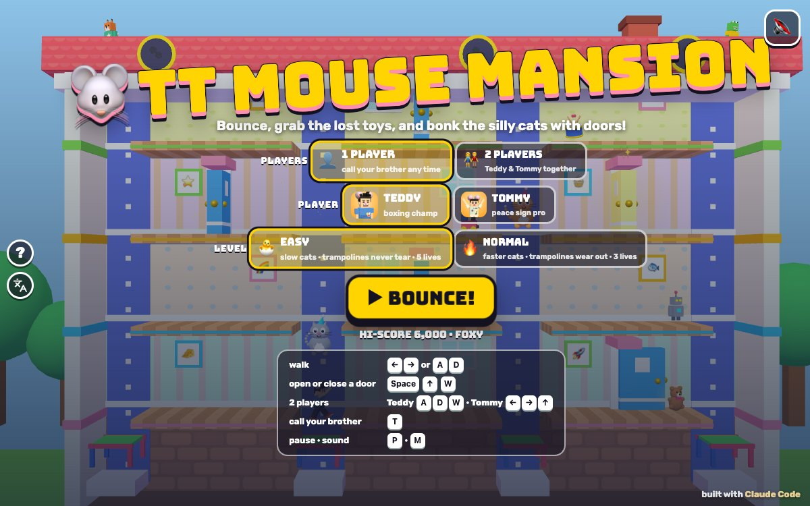](https://adong.github.io/mouse-mansion-tt/) | 🐭 **TT Mouse Mansion**: Be little mouse heroes bouncing on trampolines through a toy mansion to find the lost toys. Swing doors open to bonk the silly cats that chase you. 1 or 2 players. 老鼠大宅：戴上老鼠耳朵，在玩具大宅的蹦床上蹦上蹦下，把丢了的玩具找回来，推开门撞走追你的调皮猫咪。单人或双人。 | [play](https://adong.github.io/mouse-mansion-tt/) | [adong/mouse-mansion-tt](https://github.com/adong/mouse-mansion-tt) |
| [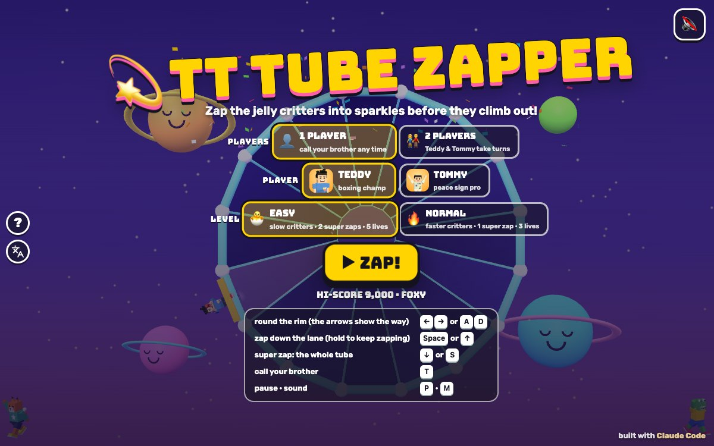](https://adong.github.io/tube-zapper-tt/) | 💫 **TT Tube Zapper**: Look down a glowing 16-lane tube: spin your zapper round the rim and zap the jelly critters climbing up into sparkles before they reach the top. A new tube shape every level. 隧道激光：一条发光的 16 跑道隧道，把激光炮沿着隧道口转一转，在果冻怪爬上来之前把它们变成小星星。每一关隧道形状都不一样。 | [play](https://adong.github.io/tube-zapper-tt/) | [adong/tube-zapper-tt](https://github.com/adong/tube-zapper-tt) |
| [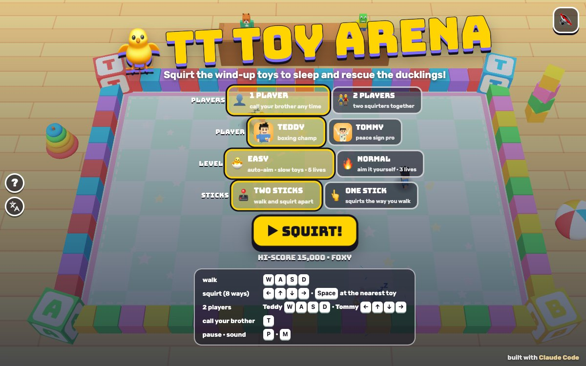](https://adong.github.io/toy-arena-tt/) | 🐥 **TT Toy Arena**: Wind-up toys march onto the play rug: move one way and squirt your water blaster another, put the toys to sleep and rescue the lost ducklings. 1 or 2 players. 玩具竞技场：发条玩具走上游戏地毯，一边走一边用水枪往任意方向喷，让玩具睡着，再救出迷路的小鸭子。单人或双人。 | [play](https://adong.github.io/toy-arena-tt/) | [adong/toy-arena-tt](https://github.com/adong/toy-arena-tt) |
|  | 🍬 **TT Candy Jumper**: Leap sky high in a superhero cape, open it to float down slowly, and grab all 24 fizzy candies. Take the glowing one each time for a bigger bonus. 跳跳糖果：披着披风跳得高高的，打开披风慢慢飘下来，把 24 颗跳跳糖果全抓到。每次抓发光的那颗，奖励更多。 | [play](https://adong.github.io/candy-jumper-tt/) | [adong/candy-jumper-tt](https://github.com/adong/candy-jumper-tt) |
|  | 🌦️ **TT Rainbow Climb**: Throw rainbows to make bridges and climb tall islands as the water rises, turn critters into fruit and reach the treasure chest at the top. 4 islands of 4 rounds. 彩虹桥：扔出彩虹当桥往上爬，水一直在涨，把小怪物变成水果，爬到小岛顶上的宝箱。4 座小岛，每座 4 关。 | [play](https://adong.github.io/rainbow-climb-tt/) | [adong/rainbow-climb-tt](https://github.com/adong/rainbow-climb-tt) |
| [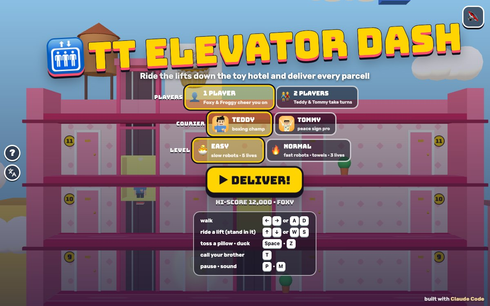](https://adong.github.io/elevator-dash-tt/) | 🛗 **TT Elevator Dash**: Ride the lifts down a toy hotel and deliver each parcel to the door with the glowing light. Toss a soft pillow at the silly bellhop robots, then jump in the delivery van. 5 hotels of 12 floors. 电梯快递：坐电梯一层一层往下走，把包裹送到亮灯的门口，用软枕头砸晕调皮的门童机器人，最后跳上快递车。5 家酒店，每家 12 层。 | [play](https://adong.github.io/elevator-dash-tt/) | [adong/elevator-dash-tt](https://github.com/adong/elevator-dash-tt) |

### ⚽ Sports / 体育运动 (26)

| | Game | Play | Code |
|---|---|---|---|
|  | ⛹️ **BuckeTT Bros**: 2-on-2 street basketball: Team Teddy & Tommy, with dunks and alley-oops. 1 or 2 players. 2 对 2 街头篮球：Teddy & Tommy 队，扣篮加空中接力。单人或双人。 | [play](https://adong.github.io/buckett-bros/) | [adong/buckett-bros](https://github.com/adong/buckett-bros) |
|  | 🏀 **SwishTT Shot**: An arcade basketball shooting machine: sink Teddy's jump shot before the 60-second clock runs out. 投篮机：60 秒倒计时结束前，用 Teddy 的跳投多进几个球。 | [play](https://adong.github.io/swishtt-shot/) | [adong/swishtt-shot](https://github.com/adong/swishtt-shot) |
|  | 🏐 **VolleyBaTTle**: Beach volleyball, brother vs brother: jump, spike and dive. 1 or 2 players. 兄弟对决沙滩排球：跳、扣、扑救。单人或双人。 | [play](https://adong.github.io/volleyball-teddy/) | [adong/volleyball-teddy](https://github.com/adong/volleyball-teddy) |
|  | 🎾 **Tennis: Teddy & Tommy**: Teddy vs Tommy on the park court: smash, lob, and call your brother for doubles. 1 or 2 players. Teddy 对 Tommy 公园网球赛：扣杀、高吊，还能叫兄弟来打双打。单人或双人。 | [play](https://adong.github.io/tennis-teddy/) | [adong/tennis-teddy](https://github.com/adong/tennis-teddy) |
|  | 🏓 **TT Table Tennis**: TT means Table Tennis, and Teddy & Tommy: swipe through the ball to smash and spin it. 1 or 2 players. 乒乓球：TT 是 Table Tennis，也是 Teddy & Tommy。挥拍一划，就能扣杀、打旋转球。单人或双人。 | [play](https://adong.github.io/tt-table-tennis/) | [adong/tt-table-tennis](https://github.com/adong/tt-table-tennis) |
|  | ⚽ **Soccer TT**: 5-a-side street soccer: Team TT against a cup ladder of silly rivals, with super shots and slow-motion goal replays. 1 or 2 players. 五人街头足球：TT 队挑战一路搞笑的对手，有超级射门和进球慢镜头回放。单人或双人。 | [play](https://adong.github.io/soccer-tt/) | [adong/soccer-tt](https://github.com/adong/soccer-tt) |
|  | 🏎️ **TT Kart**: Go-kart races: six cartoon tracks, silly item boxes, a Grand Prix trophy, split-screen for two and a time trial. 卡丁车比赛：六条卡通赛道、道具箱、奖杯大奖赛、上下分屏双人和计时赛。 | [play](https://adong.github.io/kart-tt/) | [adong/kart-tt](https://github.com/adong/kart-tt) |
| [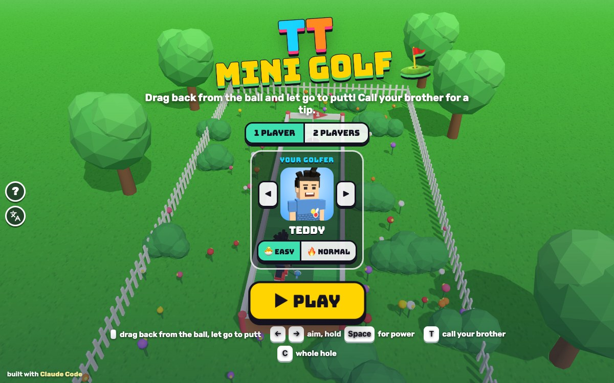](https://adong.github.io/mini-golf-tt/) | ⛳ **TT Mini Golf**: 3D mini golf: pull back like a slingshot and putt past ramps, bumpers, a windmill and a loop-the-loop. Two courses of 9 holes, 1 or 2 players. 3D 迷你高尔夫：像弹弓一样往后拉再放手，穿过坡道、弹弹蘑菇、大风车和大回环。两个球场各 9 洞，单人或双人。 | [play](https://adong.github.io/mini-golf-tt/) | [adong/mini-golf-tt](https://github.com/adong/mini-golf-tt) |
| [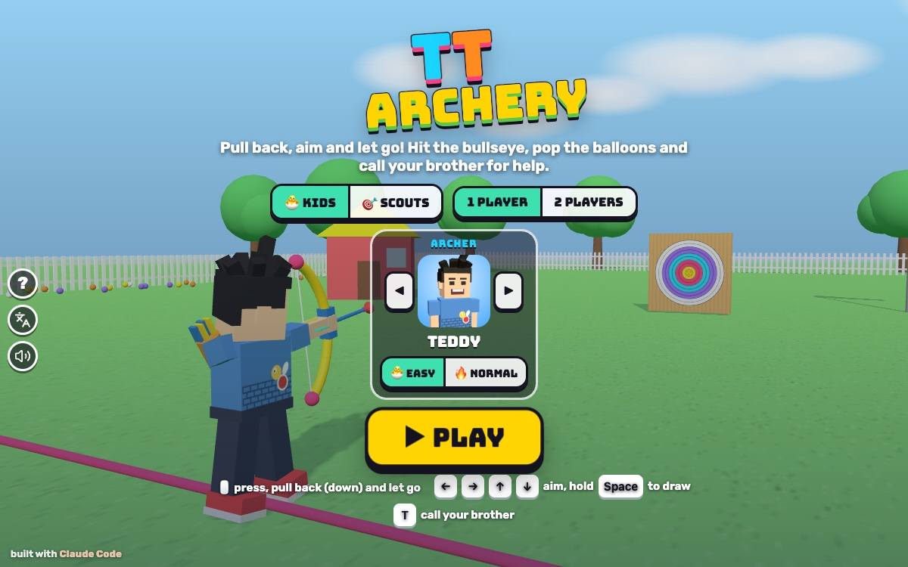](https://adong.github.io/archery-tt/) | 🏹 **TT Archery**: Pull back, aim and let go: a toy bow for kids or a real archery range for scouts, with targets, balloons and moving targets. 射箭游戏：拉弓、瞄准、松手，射靶心、射气球、射会动的靶；有儿童和童子军两种样子。 | [play](https://adong.github.io/archery-tt/) | [adong/archery-tt](https://github.com/adong/archery-tt) |
| [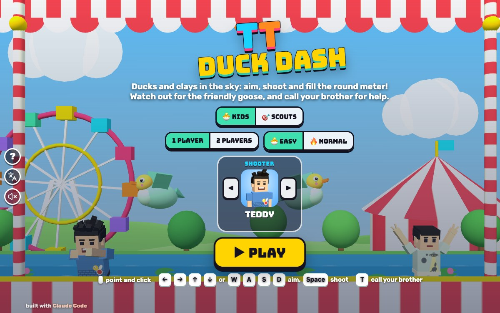](https://adong.github.io/duck-dash-tt/) | 🦆 **TT Duck Dash**: Duck and clay shooting: 1 duck, 2 ducks or clays, with a suction-cup blaster for kids or a real shotgun for scouts. 1 or 2 players. 打鸭子和飞碟射击：一只鸭、两只鸭或飞碟，儿童模式用吸盘枪，童子军模式用真霰弹枪。单人或双人。 | [play](https://adong.github.io/duck-dash-tt/) | [adong/duck-dash-tt](https://github.com/adong/duck-dash-tt) |
|  | 🎳 **TT Bowling**: 3D ten-pin bowling: swipe to bowl, strikes and spares with celebrations, bumpers and a ramp for Tommy. 1 to 4 players. 3D 保龄球：滑动出球，全中、补中都有庆祝；Tommy 可以开护栏、用滑梯推球。1 到 4 人。 | [play](https://adong.github.io/bowling-tt/) | [adong/bowling-tt](https://github.com/adong/bowling-tt) |
| [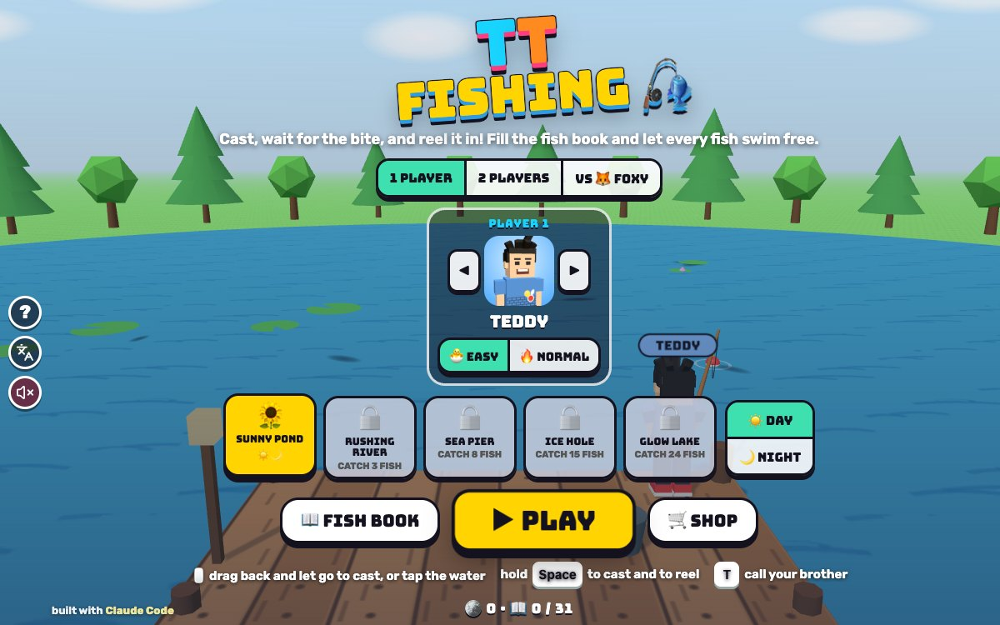](https://adong.github.io/fishing-tt/) | 🎣 **TT Fishing**: Cast, wait for the bite and reel in 31 cartoon fish at five spots, then take a photo and let them go. A fish book to fill. 钓鱼游戏：在五个地方钓 31 种卡通鱼，拍照后放生，集满鱼类图鉴。 | [play](https://adong.github.io/fishing-tt/) | [adong/fishing-tt](https://github.com/adong/fishing-tt) |
| [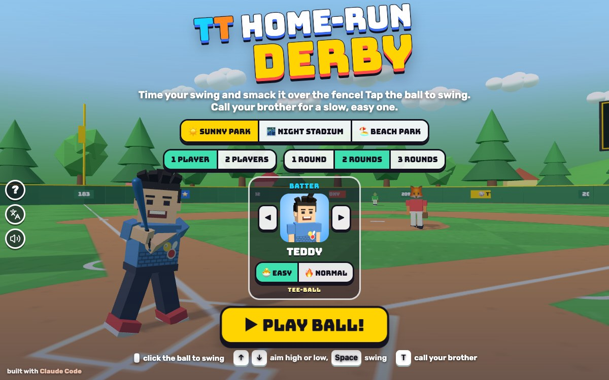](https://adong.github.io/homerun-tt/) | ⚾ **TT Home-run Derby**: Time your swing and hit it over the fence: tee-ball for Tommy, fastballs and curves for Teddy, 10 outs a round. 全垒打大赛：挥棒把球打出围墙！Tommy 用球座，Teddy 打快速球和曲线球，10 个出局一局。 | [play](https://adong.github.io/homerun-tt/) | [adong/homerun-tt](https://github.com/adong/homerun-tt) |
| [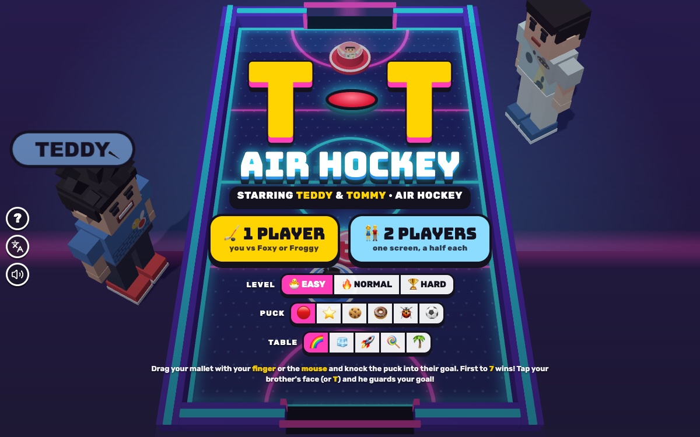](https://adong.github.io/air-hockey-tt/) | 🏒 **TT Air Hockey**: A glowing air-hockey table: knock the puck off the walls into the goal, first to 7. Play Foxy or Froggy, or each other. 桌上冰球：把冰球撞到墙上弹进球门，先进 7 个球就赢。和 Foxy、Froggy 或者两人对战。 | [play](https://adong.github.io/air-hockey-tt/) | [adong/air-hockey-tt](https://github.com/adong/air-hockey-tt) |
|  | 🔔 **TT Boxing Ring**: Cartoon boxing with big soft gloves: jab, cross, hook, block and duck through three rounds on points, and nobody gets hurt. Play Foxy or Froggy, or each other. 拳击：戴上软软的大拳套，刺拳、直拳、勾拳、防守、躲闪，打三个回合比得分，谁都不会受伤。和 Foxy、Froggy 或兄弟对战。 | [play](https://adong.github.io/boxing-ring-tt/) | [adong/boxing-ring-tt](https://github.com/adong/boxing-ring-tt) |
|  | ⛷️ **TT Ski Downhill**: Slalom down a snowy mountain through the gates, fly off ramps and dodge friendly snowmen. Time trial, race Foxy and Froggy, or race each other on a split screen. 滑雪：穿过红蓝旗门，飞过跳台，绕开雪人，一路滑到终点。可以计时，也可以和 Foxy、Froggy 或兄弟比赛。 | [play](https://adong.github.io/ski-tt/) | [adong/ski-tt](https://github.com/adong/ski-tt) |
|  | 🏅 **TT Track & Field**: A sports day with the 100 m sprint, long jump, javelin and hurdles: tap left, right, left, right to run, then jump, throw or hop, and win medals on the podium. 田径运动会：100 米跑、跳远、标枪和跨栏，快快点按钮跑起来，站上领奖台拿金牌。 | [play](https://adong.github.io/track-field-tt/) | [adong/track-field-tt](https://github.com/adong/track-field-tt) |
| [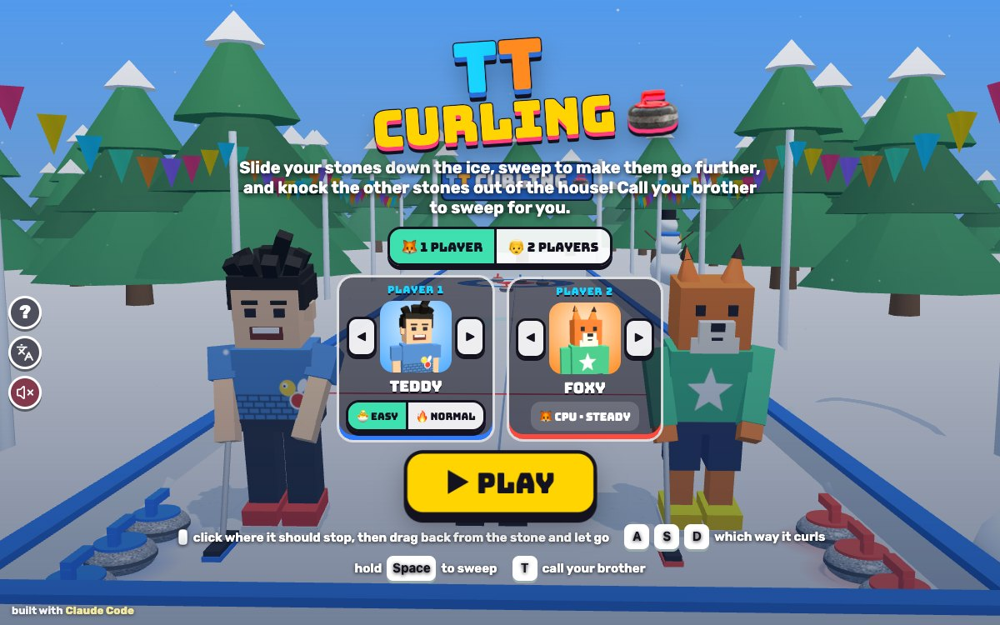](https://adong.github.io/curling-tt/) | 🥌 **TT Curling**: 3D curling on an outdoor rink: aim, spin and let go, then sweep to slide further. Knock the other stones out and score the most in four ends. 3D 冰壶：瞄准、旋转、松手，滑的时候刷冰让它滑得更远。把对手的冰壶撞出大本营，4 局比完分高的赢。 | [play](https://adong.github.io/curling-tt/) | [adong/curling-tt](https://github.com/adong/curling-tt) |
|  | 🛹 **TT Skate Park**: A 3D skate park with a half-pipe, ramps and rails: ollie, kickflip, grab, spin and grind, and chain tricks into big combos in a 90-second run. 3D 滑板公园：在 U 型池、坡道和栏杆上跳跃、翻板、抓板、滑杆，连成高分连招。 | [play](https://adong.github.io/skate-tt/) | [adong/skate-tt](https://github.com/adong/skate-tt) |
|  | 🏸 **TT Badminton**: Side-view badminton with clears, drop shots and jumping smashes. Singles or doubles against Froggy and Foxy, or each other. First to 11 wins. 横版羽毛球：高远球、吊球和跳起来扣杀。单打或双打，和 Froggy、Foxy 或兄弟对打，先得 11 分就赢。 | [play](https://adong.github.io/badminton-tt/) | [adong/badminton-tt](https://github.com/adong/badminton-tt) |
|  | 🎯 **TT Darts**: Aim, wait for the wobble and throw: a soft suction-cup board for kids or a real dartboard, playing 301 or Around the Clock. 飞镖：瞄准靶，看准晃动的时机扔出去。有吸盘软靶和真飞镖靶，玩 301 或数字转一圈。 | [play](https://adong.github.io/darts-tt/) | [adong/darts-tt](https://github.com/adong/darts-tt) |
| [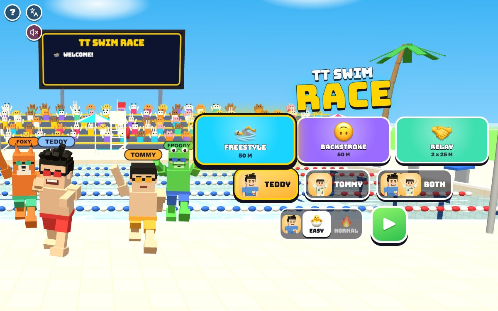](https://adong.github.io/swim-tt/) | 🏊 **TT Swim Race**: A rhythm swimming race at a sunny pool: stroke and breathe on the beat in freestyle, backstroke and a relay with your brother. 游泳比赛：在阳光泳池里跟着节拍划水和换气，有自由泳、仰泳，还有兄弟接力。 | [play](https://adong.github.io/swim-tt/) | [adong/swim-tt](https://github.com/adong/swim-tt) |
| [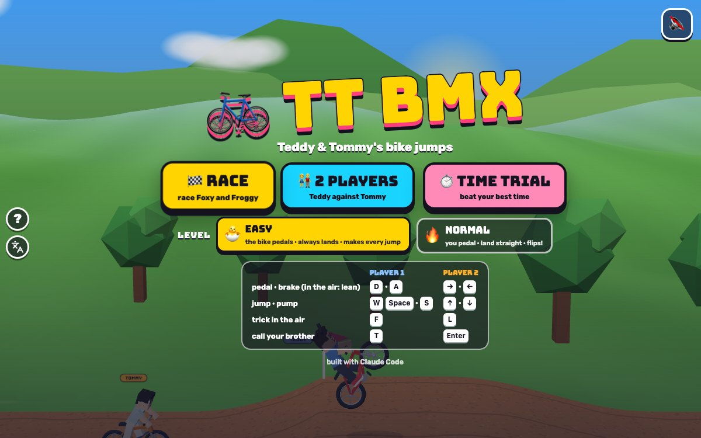](https://adong.github.io/bmx-tt/) | 🚲 **TT BMX**: Side-view BMX: pump the rollers, fly the jumps, land a backflip for a boost, and race Foxy and Froggy, your best time, or each other on a split screen. 小轮车：飞过跳台，压过小土包，在空中翻跟头加速，和 Foxy、Froggy、自己的纪录或兄弟比赛。 | [play](https://adong.github.io/bmx-tt/) | [adong/bmx-tt](https://github.com/adong/bmx-tt) |
|  | 🏄 **TT Surf**: Ride a big rolling wave: carve, fly off the top, spin and land, wave to the dolphins and dodge the seaweed before the white water catches you. 冲浪：在大浪上滑上滑下，冲到浪顶飞起来转圈，跟海豚打招呼，躲开海草。 | [play](https://adong.github.io/surf-tt/) | [adong/surf-tt](https://github.com/adong/surf-tt) |
| [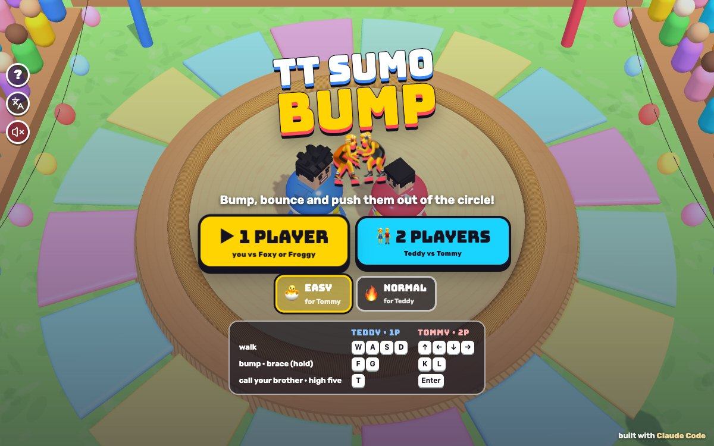](https://adong.github.io/sumo-tt/) | 🤼 **TT Sumo Bump**: Bouncy cartoon sumo in big padded suits: bump and brace to push the other wrestler out of the ring. First to 3 wins. Play Foxy, Froggy or each other. 相扑碰碰：穿上大大的充气相扑服，碰一碰、顶一顶，把对手推出圆圈，先得 3 分就赢。 | [play](https://adong.github.io/sumo-tt/) | [adong/sumo-tt](https://github.com/adong/sumo-tt) |
| [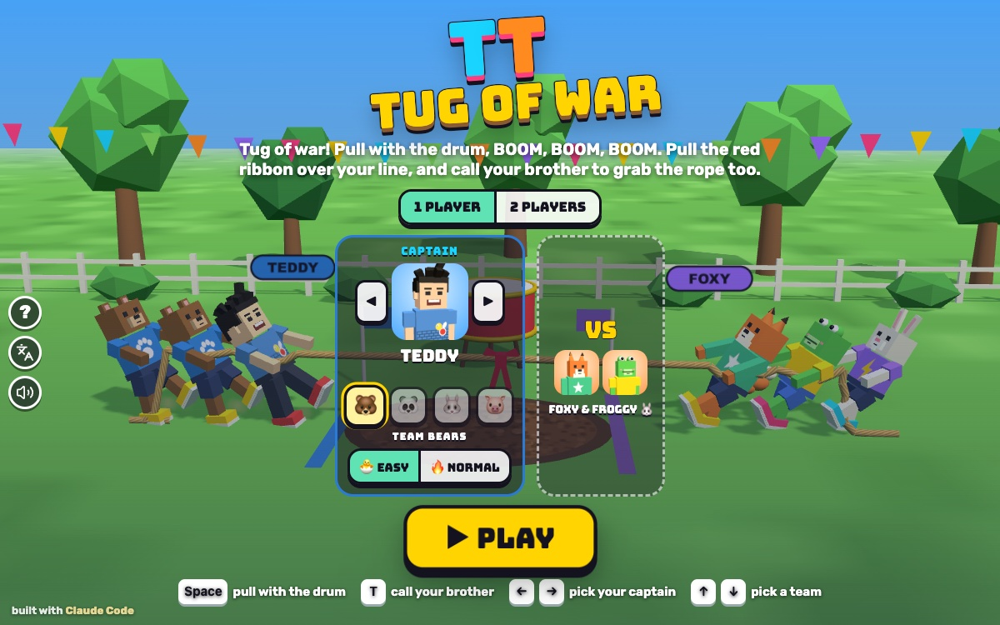](https://adong.github.io/tug-of-war-tt/) | 🪢 **TT Tug of War**: Tug of war over a mud puddle: pull on the drum beat with your bear, panda, bunny or piglet team, and drag the ribbon over your line. 拔河比赛：跟着鼓声用力拉，带上小熊、熊猫、小兔或小猪队，把红丝带拉过你的线。 | [play](https://adong.github.io/tug-of-war-tt/) | [adong/tug-of-war-tt](https://github.com/adong/tug-of-war-tt) |

### ♟️ Board Games / 棋类和桌游 (15)

| | Game | Play | Code |
|---|---|---|---|
|  | ⭕ **TT Tic-Tac-Toe**: Tic-tac-toe on a big wooden board in the garden, with Teddy as X and Tommy as O: the classic game, or SPIN, where every tap turns a square over. 1 or 2 players. 花园里的大井字棋，Teddy 是 X，Tommy 是 O：普通模式，或者旋转模式（每点一下，格子就翻一面）。单人或双人。 | [play](https://adong.github.io/tic-tac-toe-tt/) | [adong/tic-tac-toe-tt](https://github.com/adong/tic-tac-toe-tt) |
|  | ⚫ **TT Gomoku**: Five in a row on a garden board: 9×9, 13×13 or the classic 15×15. 1 or 2 players. 花园里的五子棋：五个连成一线就赢！9×9、13×13 和 15×15 棋盘，单人或双人。 | [play](https://adong.github.io/gomoku-tt/) | [adong/gomoku-tt](https://github.com/adong/gomoku-tt) |
|  | 🎲 **TT Flying Chess**: Flying chess on a 3D board: roll a 6 to take off, jump, fly across the dashed lines and bonk planes home. 2 to 4 players, kids and CPU friends. 3D 飞行棋：掷到 6 起飞，跳、飞、把别人的飞机撞回机场。2 到 4 人，小朋友和电脑朋友一起玩。 | [play](https://adong.github.io/flying-chess-tt/) | [adong/flying-chess-tt](https://github.com/adong/flying-chess-tt) |
|  | 🎉 **TT Party**: A party board game in a backyard theme park: roll the big die, collect coins and stars, and play a mini-game from the other games after every round. 后院游乐园派对棋：掷骰子、收金币、买星星，每回合玩一个来自兄弟俩其他游戏的小游戏。 | [play](https://adong.github.io/party-tt/) | [adong/party-tt](https://github.com/adong/party-tt) |
|  | ♟️ **TT Chess**: Chess on a 3D garden board: play Foxy the CPU friend (Easy, Normal or Hard), 2 players, and a LEARN mode with a lesson for every piece. 花园里的 3D 国际象棋：和电脑朋友 Foxy 下（简单、普通、困难），两人一起玩，还有每个棋子一节小课。 | [play](https://adong.github.io/chess-tt/) | [adong/chess-tt](https://github.com/adong/chess-tt) |
|  | 🔴 **TT Checkers**: Checkers on a picnic blanket: jumps, multi-jumps and little gold crowns, against Foxy the CPU friend or 2 players. 野餐垫上的西洋跳棋：跳吃、连跳、升王戴金冠！单人或双人。 | [play](https://adong.github.io/checkers-tt/) | [adong/checkers-tt](https://github.com/adong/checkers-tt) |
|  | ⭐ **TT Star Checkers**: Chinese checkers on a 3D star board: step or hop, chain long jumps and race your marbles home. 2 to 6 players with CPU friends. 3D 跳棋：走一步或者连跳，先把弹珠全部送到对面的角就赢。2 到 6 人，可以和电脑朋友一起玩。 | [play](https://adong.github.io/star-checkers-tt/) | [adong/star-checkers-tt](https://github.com/adong/star-checkers-tt) |
|  | 🟡 **TT Four in a Row**: Drop discs into the big garden board: four in a row wins, or five on the big board. Play Foxy or each other. 花园里的四子棋：棋子掉到最下面，连成四个就赢；大棋盘要连成五个。单人或双人。 | [play](https://adong.github.io/four-in-a-row-tt/) | [adong/four-in-a-row-tt](https://github.com/adong/four-in-a-row-tt) |
|  | 🪜 **TT Snakes & Ladders**: Snakes and ladders on a 3D table board: roll, count the hops, climb the ladders, slide down the friendly snakes and land on 100 exactly. 2 to 4 players with CPU friends. 3D 蛇梯棋：掷骰子、数着跳，爬梯子，顺着友好的小蛇滑下来，正好停在 100 就赢！2 到 4 人，可以和电脑朋友一起玩。 | [play](https://adong.github.io/snakes-ladders-tt/) | [adong/snakes-ladders-tt](https://github.com/adong/snakes-ladders-tt) |
|  | 🔘 **TT Flip Discs**: Trap the other colour in a line and every trapped disc flips to yours, on a little 6×6 board or the big 8×8 one. Play Foxy or each other. 花园里的黑白棋：把对方的棋子夹在中间，就会翻成你的颜色。6×6 小棋盘或 8×8 大棋盘，和 Foxy 或者两人对下。 | [play](https://adong.github.io/flip-discs-tt/) | [adong/flip-discs-tt](https://github.com/adong/flip-discs-tt) |
|  | ⚓ **TT Sea Battle**: Hide your ships on a toy sea, then take turns firing the cannon: SPLASH is water, BONK is a ship. An 8×8 sea for Tommy, 10×10 for Teddy. Play Foxy or each other. 海战：藏好战舰，轮流朝对方的海开炮，把对方的战舰全部击沉就赢！Tommy 玩 8×8，Teddy 玩 10×10；和 Foxy 对战或两人轮流。 | [play](https://adong.github.io/sea-battle-tt/) | [adong/sea-battle-tt](https://github.com/adong/sea-battle-tt) |
|  | ✏️ **TT Dots & Boxes**: Join the dots on a garden peg board: close the fourth side of a box to claim it and go again. Grids from 3×3 to 6×6. Play Foxy or each other. 点格棋：轮流把两个点连成线，连上方格的第四条边，方格就归你，还能再走一步！棋盘从 3×3 到 6×6，和 Foxy 或者两人对下。 | [play](https://adong.github.io/dots-boxes-tt/) | [adong/dots-boxes-tt](https://github.com/adong/dots-boxes-tt) |
|  | 🥜 **TT Mancala**: Scoop up a pit's seeds and sow them round the board: end in your store to go again, or in an empty pit to grab the seeds across. Play Foxy or each other. 野餐垫上的播棋：选一个小坑，把种子一颗一颗播下去，落进仓库再走一次，落进空坑就抓走对面的种子！和 Foxy 或者两人对下。 | [play](https://adong.github.io/mancala-tt/) | [adong/mancala-tt](https://github.com/adong/mancala-tt) |
|  | 🔲 **TT Dominoes**: Dominoes on a felt table: match the ends with Foxy and Froggy, 2 to 4 players. Then TOPPLE! Draw lines of rainbow dominoes with your finger and knock them all down. 多米诺骨牌：和 Foxy、Froggy 一起玩接龙，2 到 4 人。还有推倒骨牌：用手指画线摆骨牌，推一下，看它们一张接一张倒下！ | [play](https://adong.github.io/dominoes-tt/) | [adong/dominoes-tt](https://github.com/adong/dominoes-tt) |
|  | 🌈 **TT Color Cards**: A card game on a felt mat: match the color or number, play SKIP, REVERSE and +2, and be first to empty your hand. 2 to 4 players with Foxy and Froggy. 颜色卡牌：颜色一样或数字一样就能出，还有跳过、掉头和加两张，谁先出完谁赢。2 到 4 人，和 Foxy、Froggy 一起玩。 | [play](https://adong.github.io/color-cards-tt/) | [adong/color-cards-tt](https://github.com/adong/color-cards-tt) |

### 🧠 Brain & Learning / 益智学习 (17)

| | Game | Play | Code |
|---|---|---|---|
|  | 🧩 **BeTTer TogeTTher**: Teamwork puzzles: orange paths for Teddy, mint ones for Tommy. 10 levels, best with 2 players. 合作解谜：橙色的路给 Teddy，薄荷绿的路给 Tommy。10 关，两个人玩最好玩。 | [play](https://adong.github.io/coop-brothers/) | [adong/coop-brothers](https://github.com/adong/coop-brothers) |
|  | 🧸 **Tommy's Toy Box**: Whack-a-zombie and memory cards for little hands. 打僵尸和记忆翻牌，给小小手玩的。 | [play](https://adong.github.io/tommy-toybox/) | [adong/tommy-toybox](https://github.com/adong/tommy-toybox) |
|  | 🐄 **Spot TT Animals**: Teddy's own game: look through binoculars into a cornfield and count the farm animals before time runs out. 1 or 2 players. Teddy 自己设计的游戏：用望远镜看玉米地，在时间用完前数清农场动物。单人或双人。 | [play](https://adong.github.io/spot-tt-animals/) | [adong/spot-tt-animals](https://github.com/adong/spot-tt-animals) |
|  | 🎈 **TT Word Pop**: Pop the balloons to learn words: English spelling, or Chinese characters with pinyin when you switch language. Easy for Tommy, Normal for Teddy. 戳气球学认字：英文模式练拼写，中文模式认汉字（有拼音、有图片、会读出来）。 | [play](https://adong.github.io/word-pop-tt/) | [adong/word-pop-tt](https://github.com/adong/word-pop-tt) |
|  | 🧮 **ProTigy**: A math adventure: win pet battles by answering math at your own level (Kindergarten to grade 6), collect 300 pets and explore seven zones. 数学探险：按自己的水平答题打赢宠物对战，收集 300 只宠物，走过七个地区。 | [play](https://adong.github.io/protigy/) | [adong/protigy](https://github.com/adong/protigy) |
|  | 🃏 **TT Memory Match**: Flip two cards and find the pairs: animals, fruit, vehicles and more, from 2 by 3 up to 6 by 6. Play alone, together or against Foxy. 翻牌配对：动物、水果、交通工具、中国小物……从 2×3 到 6×6，一个人玩、两人轮流或和 Foxy 比。 | [play](https://adong.github.io/memory-tt/) | [adong/memory-tt](https://github.com/adong/memory-tt) |
|  | 🤖 **TT Robot Coder**: Program a little robot with picture blocks to reach the star: 40 puzzles, from one block for Tommy to loops and ifs for Teddy. 用图案指令给小机器人编程拿星星：40 关，从 Tommy 的一步小谜题到 Teddy 的循环和条件。 | [play](https://adong.github.io/robot-coder-tt/) | [adong/robot-coder-tt](https://github.com/adong/robot-coder-tt) |
|  | 🔢 **TT Sudoku**: Sudoku on a wooden tray: every row, column and box holds each one once. Fruit 4×4 for Tommy, number 6×6 and 9×9 for Teddy, with pencil notes and a fresh puzzle every time. 数独：每一行、每一列、每一宫，每样只放一次。4×4 水果数独给 Tommy，6×6 和 9×9 数字数独给 Teddy，还能写铅笔小记号。 | [play](https://adong.github.io/sudoku-tt/) | [adong/sudoku-tt](https://github.com/adong/sudoku-tt) |
|  | 🟩 **TT Picture Grid**: Picture-grid puzzles: fill the cells the numbers tell you and a pixel picture appears. 29 pictures from a 5×5 heart to a 15×15 panda, plus a race mode. 数织：按照每行每列的数字涂格子，涂完就出现一幅彩色图画。29 幅图，从 5×5 爱心到 15×15 熊猫，还有比赛模式。 | [play](https://adong.github.io/picture-grid-tt/) | [adong/picture-grid-tt](https://github.com/adong/picture-grid-tt) |
|  | 📦 **TT Box Push**: The warehouse box-pushing puzzle: push every crate onto a gold star, and never pull. 40 levels with undo, a team mode, a race, and your brother's hint for the next push. 推箱子：把每个箱子推到金色的星星上，只能推，不能拉。40 关，可以撤销，可以两兄弟一起推，还有比赛模式。 | [play](https://adong.github.io/box-push-tt/) | [adong/box-push-tt](https://github.com/adong/box-push-tt) |
|  | 🚰 **TT Pipe Connect**: Turn the pipes so the water runs from the tap to every flower. 40 gardens from 3×3 to 7×7, with a team mode, a race and your brother to turn a pipe for you. 接水管：旋转水管，让水从水龙头流到每一朵花。40 关，从 3×3 到 7×7，还有组队和比赛模式。 | [play](https://adong.github.io/pipes-tt/) | [adong/pipes-tt](https://github.com/adong/pipes-tt) |
|  | 🔍 **TT Spot the Difference**: Two nearly matching 3D pictures of a park, a beach, a snowy hill or the moon: tap every difference. Race Froggy or Foxy, or take turns with your brother. 找不同：两张几乎一样的 3D 小图（公园、海滩、雪山、月球），把不一样的地方都点出来。和 Froggy、Foxy 比，或者兄弟俩轮流找。 | [play](https://adong.github.io/spot-diff-tt/) | [adong/spot-diff-tt](https://github.com/adong/spot-diff-tt) |
|  | 🖼️ **TT Jigsaw**: Jigsaw puzzles of six little 3D scenes, from 6 pieces for Tommy to 100 for Teddy. Beat your best time, race Froggy or Foxy, or build one together. 拼图：六张 3D 小图，从 6 块到 100 块。打破最快纪录，和 Froggy、Foxy 比赛，或者兄弟俩一起拼。 | [play](https://adong.github.io/jigsaw-tt/) | [adong/jigsaw-tt](https://github.com/adong/jigsaw-tt) |
|  | 🚀 **TT Rocket**: Build a rocket from parts, blast off, steer into orbit and land on the Moon, Mars and beyond, collecting a planet card with true facts on every mission. 自己造火箭：选零件，发射，飞进轨道，降落在月球、火星和更远的地方，收集星球卡片。 | [play](https://adong.github.io/rocket-tt/) | [adong/rocket-tt](https://github.com/adong/rocket-tt) |
|  | ⌨️ **TT Typing**: A typing adventure: learn the home-row keys a pair at a time, then type words to power your hero along a trail to the treasure chest. 打字冒险：先学键盘基本功，再打单词让小英雄一路冲到宝箱。中文模式打拼音。 | [play](https://adong.github.io/typing-tt/) | [adong/typing-tt](https://github.com/adong/typing-tt) |
|  | 🕒 **TT Clock & Shop**: Learn to read clocks and use money in a little toy shop with a cuckoo clock: o'clock and half past for Tommy, minutes and making change for Teddy. 认钟表和购物：在玩具小店里认钟表、数硬币、付钱和找零，美元和人民币都能玩。 | [play](https://adong.github.io/clock-shop-tt/) | [adong/clock-shop-tt](https://github.com/adong/clock-shop-tt) |
|  | 🌍 **TT World & Space**: A space quiz show: flags, countries on a spinning globe and the planets of the Solar System. Spin the globe and win a star for every right answer. 地球和太空问答秀：认国旗、在地球仪上找国家、认识八大行星，答对一次得一颗星。 | [play](https://adong.github.io/flags-planets-tt/) | [adong/flags-planets-tt](https://github.com/adong/flags-planets-tt) |

### 🎨 Make & Play / 创作玩乐 (7)

| | Game | Play | Code |
|---|---|---|---|
|  | 🎱 **Magic 8: Teddy & Tommy**: Ask a question and shake the ball, and the brothers answer. 问个问题，摇一摇魔法球，兄弟俩来回答。 | [play](https://adong.github.io/magic-8-teddy/) | [adong/magic-8-teddy](https://github.com/adong/magic-8-teddy) |
|  | 🍳 **TT Kitchen**: A co-op cooking game: chop, cook, plate, serve and wash up across 10 ever-sillier kitchens. Best with 2 players. Teddy 和 Tommy 一起当大厨：切菜、煮饭、装盘、上菜、洗盘子，10 个越来越搞笑的厨房，两个人一起玩最好玩。 | [play](https://adong.github.io/kitchen-tt/) | [adong/kitchen-tt](https://github.com/adong/kitchen-tt) |
|  | 🕺 **TT Dance Party**: A rhythm dance game on a backyard disco stage: six original songs, hit the arrows on the beat and Teddy and Tommy dance. 后院迪斯科跳舞游戏：六首原创歌曲，箭头落下就按键，Teddy 和 Tommy 跟着节拍跳舞。 | [play](https://adong.github.io/dance-party-tt/) | [adong/dance-party-tt](https://github.com/adong/dance-party-tt) |
|  | ⛏️ **TT Blocks**: A block-building world on your own little island: dig, build, fly, find golden stars and meet puffy sheep and chicks. 方块建造世界：在自己的小岛上挖、建造、飞行，找金星星，和小羊、小鸡交朋友。 | [play](https://adong.github.io/blocks-tt/) | [adong/blocks-tt](https://github.com/adong/blocks-tt) |
|  | 🎹 **TT Music Maker**: A music studio: play piano, xylophone, a guzheng-style pluck, flute and drums, record, make beats and learn five songs. 音乐工作室：弹钢琴、木琴、古筝、笛子和架子鼓，录音、做节拍，学五首儿歌。 | [play](https://adong.github.io/music-maker-tt/) | [adong/music-maker-tt](https://github.com/adong/music-maker-tt) |
|  | 🖍️ **TT Coloring**: A coloring book with 16 pictures: tap to fill with crayon colors, draw with the brush and add stickers. Every page is saved, and your brother suggests colors. 涂色本：16 张线稿，点一下就涂满，也可以用画笔画、贴贴纸，涂好的画会存进“我的画”。 | [play](https://adong.github.io/coloring-tt/) | [adong/coloring-tt](https://github.com/adong/coloring-tt) |
|  | 🌾 **TT Farm**: Plant rice, bok choy and watermelons, feed the chickens, cow and sheep, sell at Foxy's market and see who earns more by the Harvest Fair. 1 or 2 players. 开心农场：种稻子、小白菜和西瓜，喂小鸡、奶牛和小羊，去 Foxy 的市场卖掉换金币，丰收大集比一比。单人或双人。 | [play](https://adong.github.io/farm-tt/) | [adong/farm-tt](https://github.com/adong/farm-tt) |

## How they're made

Every game is plain JavaScript on Three.js and ships as one HTML page. The characters, their poses and the sound come from a shared kit, so Teddy and Tommy look and move the same in every game. Built by Dad with [Claude Code](https://claude.com/claude-code).

Each game has one icon: its emoji on a coloured tile. The same picture is on its card here, on its browser tab, and on the iPad home screen when you add the game there. The device's own emoji font draws it, so there are no image files.

Each game's page title is its name and then "Teddy & Tommy", for example "FlaTTy Birds · Teddy & Tommy".

To add a game here, move it from `SOON` to `LIVE` in `index.html` (with its shelf `cat` from `CATS`, its English and 中文 text, its emoji and its tile colour), save its title-screen screenshot as `shots/<repo>.jpg`, add a row to its shelf's table above, and update the game counts in the headings.
